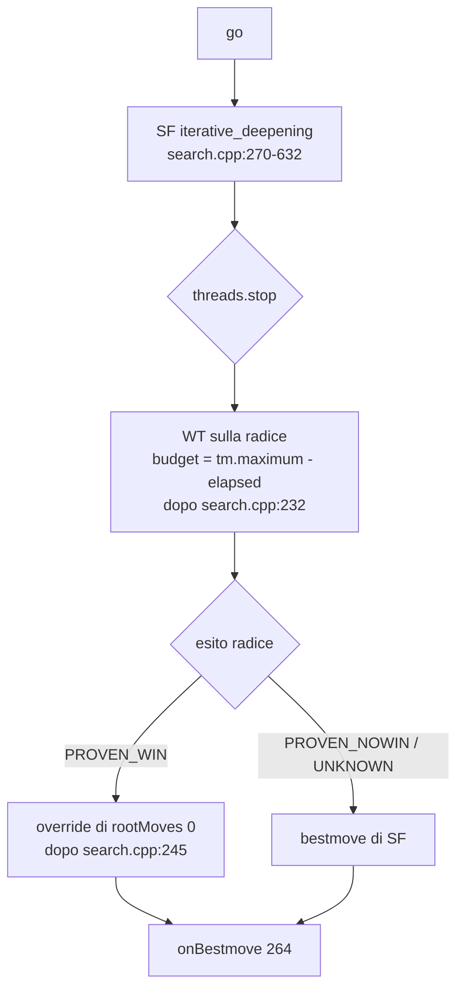
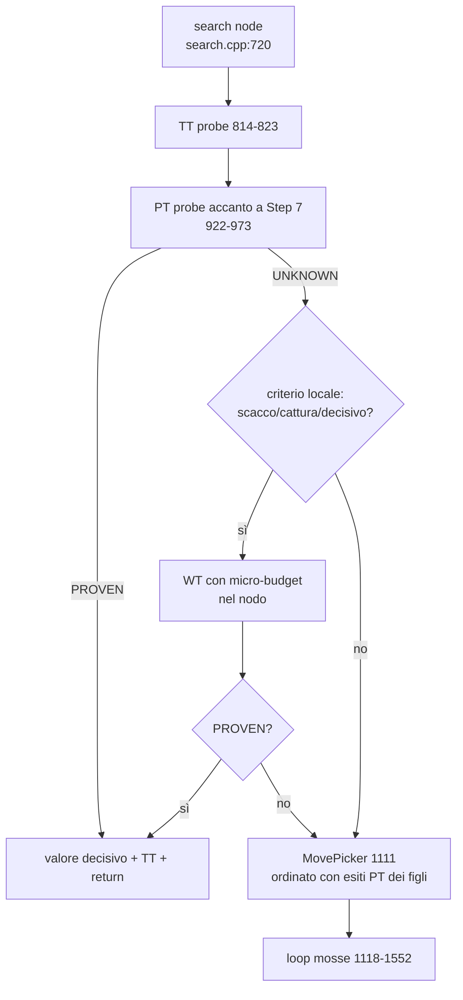
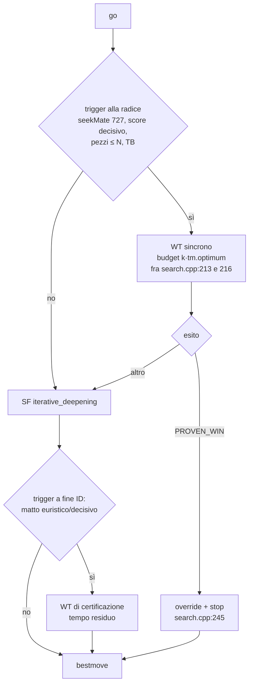
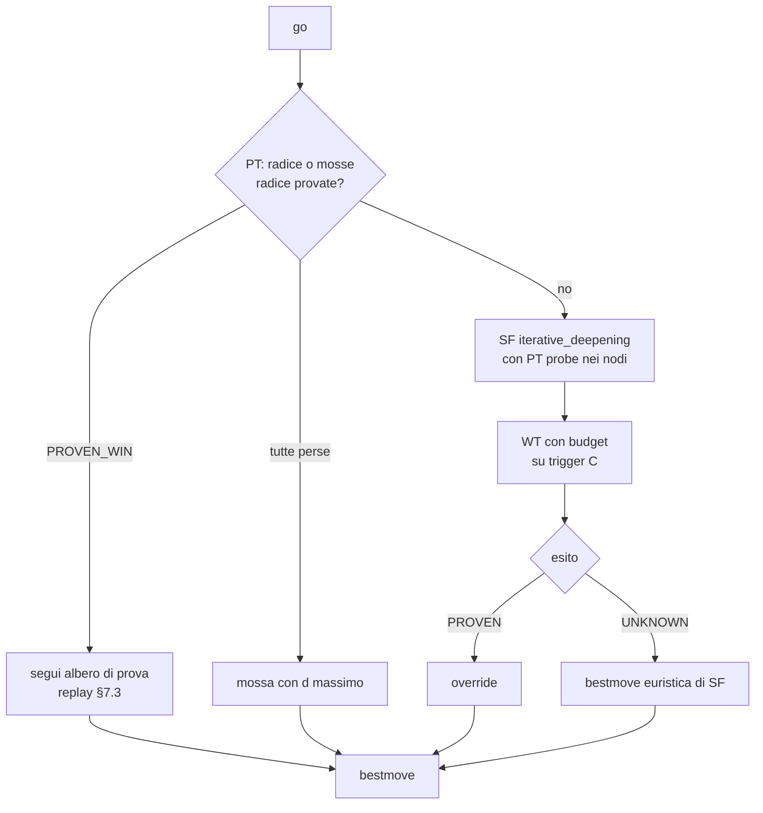
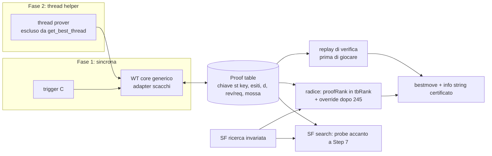

# WinTree × Stockfish 19 — progetto tecnico di un motore ibrido

Data: 2026-10-15. Stato: documento di analisi e progettazione; nessun file del repository è stato modificato. È la specifica completa per chi costruisce: le note di lavoro e i rapporti degli agenti usati per prepararlo sono stati assorbiti nel testo; l'harness è in Appendice A. Fonti: `2607.09715v2.pdf`, `two-players game engine/` (Java), `Stockfish-sf_19/` (sorgenti, identici allo zip). Etichette: [FATTO VERIFICATO] [DIMOSTRATO] [INFERENZA] [IPOTESI] [RACCOMANDAZIONE] (definite in §2).

Indice: 1 Sintesi · 2 WinTree verificato · 3 Stockfish 19 · 4 Diagrammi · 5 Confronto · 6 Architettura raccomandata · 7 Correttezza · 8 Strategia C++ · 9 Piano · 10 Rischi · 11 Criteri · 12 Attività · Appendice A (harness e output).

## 1. Sintesi esecutiva

**Che cos'è WinTree, verificato sulle fonti.** Una ricerca AND/OR depth-first su grafi di gioco con cicli: ogni vertice è TRUE (vittoria dimostrata per il giocatore obiettivo `g`), FALSE (`g` non può forzare la vittoria), oppure NIL (irrisolto per ripetizioni sul cammino). Si arresta appena trova un testimone nei nodi di `g` e appena trova una confutazione nei nodi dell'avversario. I cicli valgono "ignoto" e i vertici irrisolti non sono mai memorizzati come definitivi: per questo i risultati TRUE/FALSE sono solidi anche con le trasposizioni e le ripetizioni (il problema GHI che Stockfish gestisce solo con palliativi, `search.cpp:891-893`, `1919-1953`). Il paper dimostra correttezza, completezza alla radice, limite superiore della distanza alla vittoria e un teorema per la strategia di patta (§2.4). Costo: esponenziale nel caso peggiore; nessun budget, nessuna euristica.

**Tre risultati negativi, confermati eseguendo il codice (Appendice A).** (P1) La versione "ottimizzata" di Sez. 4.1 del paper, riprodotta dal Java, è **non solida**: un figlio risolto durante la ricorsione di un fratello viene ignorato, e il motore dichiara vittorie e non-vittorie false (viola i Thm 3.1 e Cor 3.3). (P2) L'ottimizzazione `dejavu` del Java perde la completezza alla radice e con essa la garanzia di "non perdere mai" (Thm 3.4/4.8); combinata con il trattamento speciale della radice in `solve()` (figlio NIL ⇒ FALSE) produce anche un FALSE **non solido** alla radice (fuzzing di M0, seme 191). (P3) `bestMove` ha un NPE latente. L'algoritmo base di Sez. 3 è corretto su tutti i casi. Il porting deve partire da Sez. 3 e reintrodurre le ottimizzazioni con le correzioni di §2.7; il dejavu va usato solo per cercare vittorie finché manca una dimostrazione.

**Che cosa WinTree può dare a Stockfish, e a che costo.** Non forza euristica: certificati. (i) Matti certificati (Stockfish riporta matti che sono minimax di alberi potati, non prove: §3.2). (ii) "L'avversario non può vincere" nei finali, con le tablebase come foglie: la classe delle fortezze, dove la valutazione di Stockfish è notoriamente sbagliata. (iii) Risultati incrementali che sopravvivono all'interruzione e alle mosse successive (conversione guidata dalla prova). Il prezzo è il tempo sottratto ad alpha-beta: nel mediogioco un budget dato al prover produce quasi sempre "ignoto", quindi tutto dipende da **quando** lo si invoca.

**Architettura raccomandata (E, §6).** Un nucleo WinTree C++ generico (template sul gioco, corretto rispetto a P1, con budget e con esiti distinti in: vittoria dimostrata, non-vittoria dimostrata, ignoto-per-cicli, ignoto-per-budget, euristico) + un adapter che usa `Position`, `MoveList<LEGAL>` e Syzygy di Stockfish senza copie né nuove strutture + una **tabella delle prove** separata dalla TT (chiave `st->key`, vincoli espliciti sul contatore delle 50 mosse) + un **verificatore** indipendente che certifica gli oggetti di prova (albero vincente, grafo di strategia di patta) ricostruendo le posizioni: la certezza viene dal verificatore, non dalla ricerca (§7.9). Fase 1: prover sincrono alla radice su criteri euristici (pochi pezzi, punteggi decisivi, richiesta esplicita), consumato da alpha-beta come oggi le tablebase (`search.cpp:922-973`) e alla radice tramite lo stesso meccanismo di `tbRank`. Fase 2, solo se i gate passano: prover su thread helper con tabella lockless. Le varianti "WinTree dentro ogni nodo" (B) e "WinTree sempre dopo la ricerca" (A) sono scartate con motivazioni in §5-6.

**Aspettativa onesta.** Un motore "più forte di Stockfish" in Elo generale è improbabile: il guadagno atteso è nullo o negativo salvo in classi di posizioni (finali con TB, matti lunghi, fortezze) e dipende dalla precisione del trigger. Il vantaggio algoritmico reale e misurabile è la certificazione e la gestione solida di cicli/GHI; è anche possibile che un risolutore best-first (df-pn) sia più efficiente di WinTree nel trovare i matti: va misurato (G1), e l'architettura E non dipende dall'attraversamento.

**Come si decide.** Quattro gate quantitativi (§11): G0 zero errori rispetto a oracoli (punto fisso sui grafi; WDL sulle posizioni ≤ 5 pezzi); G1 matti: ≥ 90% di quelli risolti da `go mate` a pari tempo, nodi ≤ 3× df-pn; G2 fortezze: ≥ 25% certificate dove Stockfish sbaglia di oltre 150 cp; G3 SPRT di non regressione [−3, 1] con la stessa binaria e opzione di toggle, più SPRT [0, 5] su set di finali. Prime attività: harness di test (M0), nucleo generico con test differenziali (M1), solver scacchistico standalone sui sorgenti di Stockfish (M2); l'integrazione (M3) solo dopo G0-G1.

**Esito del gate G1 e decisione (2026-10-16).** M0-M2 sono stati eseguiti (§12.1): G0 superato (0 errori su 10^4 grafi casuali e su 10^4 posizioni ≤ 5 pezzi contro le tablebase). G1 **non superato**: sulla suite intera `mates2000` (2000 posizioni, 10 s, un thread) WinTree a caldo certifica il 64,1 % dei matti che Stockfish `go mate` risolve (soglia 90 %), con mediana 7,1× e p90 332× i nodi del df-pn "da manuale" (soglie 3× e 10×), che invece arriva all'88,5 %. Decisione del committente: **df-pn diventa l'attraversamento del nucleo** (§8.1b); restano invariati architettura E, reticolo degli esiti, gestione dei cicli di WinTree (una ripetizione sul cammino non è mai una prova né una confutazione memorizzabile), verificatore e hook. Il contributo di WinTree al progetto è la semantica certificabile, non l'attraversamento. **Esito di M2c (2026-10-17)**: con il nucleo df-pn (euristica di pn/dn da scacchi, catture, ttMove e mobilità; taint di ciclo) G1 è **superato**: 96,1 % dei matti risolti da Stockfish certificati a caldo (96,0 % a freddo), nodi 0,21× il df-pn da manuale (p90 0,57×), 202 posizioni risolte che Stockfish non risolve in 10 s; G0 scacchistico ripetuto: 0 disaccordi. M3 (integrazione in una copia di Stockfish) è fatta con signature del `bench` identica e overhead del probe −0,24 % (G4). **G2 (fortezze, 2026-10-17)**: 35,1 % delle patte a 6 pezzi certificate con sink ≤ 5 pezzi (soglia superata), ma tutte per riduzione a foglie TB e nessuna senza tablebase; 2/23 fortezze di letteratura a 7-10 pezzi: **l'ipotesi H2 non è sostenuta**, la capacità unica del prover è certificare matti e riduzioni a regioni TB. **G3 (2026-10-20)**: con i default `Prover=auto` costa −2,15 ± 2,43 Elo a 10+0.1 (13 574 partite) e non dà guadagni misurabili nei finali: **non superato**; il prover produce esiti in 10 partite su 13 574, la perdita non viene dagli esiti ma, per ipotesi non verificata, dal tempo speso alla radice senza esito. Conclusione (§13): il progetto è uno strumento di certificazione (matti e riduzioni a tablebase) solido e misurato, non un motore più forte.

**Licenze (analisi tecnica, non consulenza legale).** Stockfish: GPL-3.0-or-later. Paper: CC BY-NC-SA 4.0 (testo). Codice Java: nessuna licenza ⇒ tutti i diritti riservati: serve una concessione o un'implementazione dal paper. Rete NNUE non inclusa nello zip; licenza del file di rete da verificare.
## 2. Proprietà verificate di WinTree e differenze tra paper e Java

Convenzione delle etichette usate in tutto il documento:

- **[FATTO VERIFICATO]**: letto direttamente nel sorgente/paper o osservato eseguendo codice; la citazione indica dove.
- **[DIMOSTRATO]**: teorema del paper, o argomento matematico riportato per esteso qui.
- **[INFERENZA]**: conclusione tecnica derivata dai fatti, non osservata direttamente.
- **[IPOTESI]**: congettura da verificare sperimentalmente.
- **[RACCOMANDAZIONE]**: scelta progettuale proposta.

### 2.1 Fonti analizzate

| Fonte | Identificazione | Stato |
|---|---|---|
| Paper | `2607.09715v2.pdf`, sha256 `902bc425…56fc7`, 22 pagine. "How to program a never-losing chess engine", Fabio Romano, arXiv [cs.GT], v1 24 giu 2026, v2 3 ago 2026 (data interna "August 4, 2026"). Licenza secondo la pagina arXiv: CC BY-NC-SA 4.0 (link "view license"); il PDF non la riporta. | [FATTO VERIFICATO] |
| Java | `two-players game engine/src/engine/{Engine.java 297 righe, Position.java 37, Outcome.java 5}`; progetto Eclipse (`.project`, `.classpath` JRE modulare, encoding windows-1252); `bin/` con `.class` versione 65.0 (Java SE 21). Nessun file di licenza, README, test, repository git. | [FATTO VERIFICATO] |
| Stockfish | `Stockfish-sf_19.zip` sha256 `024a509d…1119`; `src/misc.cpp:57` `constexpr std::string_view version = "19";`; `Copying.txt` = GPL v3; header dei sorgenti "either version 3 of the License, or (at your option) any later version"; `CITATION.cff` `license: GPL-3.0`. La cartella `Stockfish-sf_19/` decompressa nel progetto è identica allo zip (`diff -rq`: nessuna differenza). Nessuna modifica preesistente; nessun `.git`. La rete NNUE (`evaluate.h:36`, `nn-1a298aa575a0.nnue`) **non** è inclusa nello zip. | [FATTO VERIFICATO] |

Strumenti disponibili sulla macchina: OpenJDK 25 (runtime con `jdk.compiler`, quindi `java File.java` funziona; `javac` separato assente), g++ 16.2, clang++, make. [FATTO VERIFICATO]

### 2.2 Modello astratto del gioco (paper, Sez. 2)

[FATTO VERIFICATO, pagg. 2-3]

- Grafo diretto `G = <V, E>`. **Sink** (Def. 2.5): vertici il cui unico arco è un self-loop, `sinks(G) = {v | Adj(v) = {v}}`.
- **Game graph** (Def. 2.6) `G = <V, E, v0, win, turn>`: `v0 ∉ sinks`; per ogni non-sink `Adj(v) ≠ ∅` e `v ∉ Adj(v)`; `win: sinks → {−1, 0, 1}` (1 attaccante, −1 difensore, 0 patta); `turn: V → {1, −1}` con `turn(v) = −turn(u)` per ogni arco `(v,u)` con `v ≠ u`. L'alternanza è parte del modello: il grafo è bipartito rispetto al tratto; non esistono "mosse nulle".
- **eval** (Def. 2.7): `eval(v) = win(v)` sui sink; `max` sui figli se `turn = 1`, `min` se `turn = −1`.
- **d_g** (Def. 2.8, depth to winning): 0/∞ sui sink; `min_u d_g(u)+1` se `turn(v) = g`; `max_u d_g(u)+1` altrimenti. Negli scacchi è la DTM.
- **Lemma 2.9**: `eval(v) = g ⟺ d_g(v) < ∞`.

**Ambiguità rilevata** [INFERENZA]: la Def. 2.7 è data "per induzione", ma su un grafo con cicli l'induzione non è ben fondata (un vertice su un ciclo non ha un valore definito da max/min dei figli). La lettura coerente con il Lemma 2.9 e con tutte le dimostrazioni successive è: `d_g` è il **minimo punto fisso** della sua equazione (equivalente al calcolo dell'attrattore), `eval(v) = g ⟺ d_g(v) < ∞`, e `eval(v) = 0` quando `d_1(v) = d_−1(v) = ∞`, cioè quando nessuno dei due può forzare un sink favorevole: il gioco infinito (ciclo) vale patta. Questa è la semantica che il documento adotta ("modello astratto"). Non è esplicitata nel paper; va dichiarata come ipotesi del modello (vedi §7 per la relazione con le regole degli scacchi).

Interfaccia richiesta al gioco nel Java (`Position.java`): `equals/hashCode` (identità di stato), `Set<T> legalMoves()` (figli; vuoto ⇒ terminale: i sink del paper diventano "nessuna mossa legale"), `Outcome turn()`, `Outcome win()` definito solo sui terminali. [FATTO VERIFICATO, `Position.java:12-37`]. L'alternanza dei turni non è controllata dal motore.

### 2.3 L'algoritmo (paper, Sez. 3, pagg. 6-7)

Pseudocodice con la numerazione del paper (le righe citate nei teoremi sono queste):

```
WinTree(G,g): WinTreeRecursion(G,g,v0)
WinTreeRecursion(G,g,v):
 5   v.color ← GRAY
 6   if v ∈ sinks(G):                         ▷ base
 7-12   v.win ← (win(v) = g); v.d ← 0 se TRUE, ∞ altrimenti
14   else:                                     ▷ passo ricorsivo
15-20   if turn(v) = g: v.win ← FALSE, v.d ← ∞   else: v.win ← TRUE, v.d ← 0
22   end ← FALSE; i ← 0
24   while not end and i < |Adj(v)|:
25     w ← Adj(v)[i]
26-28  if w.color = GRAY: win ← NIL; d ← ∞       ▷ "the winning tree can't have cycles"
29-35  else: if w.color ≠ BLACK: WinTreeRecursion(G,g,w);  win ← w.win; d ← w.d + 1
36-41  if win ≠ (turn(v) ≠ g): v.win ← win; v.d ← d; if v.win ≠ NIL: end ← TRUE
42-44  else if turn(v) ≠ g and d > v.d: v.d ← d
45     i ← i + 1
48-52 if v.win = NIL: v.color ← WHITE else: v.color ← BLACK
```

Gli attributi non inizializzati valgono NIL (quindi `color = NIL` = mai visitato, distinto da WHITE = visitato ma irrisolto). [FATTO VERIFICATO, pag. 6 "Note"]

**Semantica per tipo di nodo** (derivata dalle righe 36-44) [FATTO VERIFICATO]:

| Nodo | Figlio TRUE | Figlio FALSE | Figlio NIL o GRAY | Esito finale |
|---|---|---|---|---|
| OR, `turn(v) = g` ("basta un testimone") | `v.win ← TRUE`, `v.d ← w.d+1`, **stop** | nessun effetto | `v.win ← NIL`, `v.d ← ∞`, si continua | TRUE se trovato un testimone; altrimenti NIL se almeno un figlio irrisolto; altrimenti FALSE (tutti i figli esplorati e FALSE) |
| AND, `turn(v) ≠ g` ("tutte le risposte") | `v.d ← max(v.d, w.d+1)` | `v.win ← FALSE`, `v.d ← w.d+1`, **stop** | `v.win ← NIL`, `v.d ← ∞`, si continua | FALSE se trovata una confutazione; altrimenti NIL se almeno un figlio irrisolto; altrimenti TRUE con `d = 1 + max` |

Punti essenziali per il progetto:

1. **Arresto anticipato** solo in due casi: testimone trovato in un nodo OR, confutazione trovata in un nodo AND. Un esito NIL non arresta: il nodo continua a esaminare gli altri figli (potrebbe ancora diventare TRUE/FALSE).
2. **Cicli**: un figlio GRAY (sul cammino DFS corrente) vale NIL. Un albero vincente non può contenere cicli; la ripetizione non è mai parte di una prova di vittoria, e non è neppure una confutazione: è "ignoto" per questa visita.
3. **WHITE non è memoizzato**: la riga 30 ricorre di nuovo su ogni figlio non-BLACK, inclusi i WHITE già visitati. Solo BLACK è definitivo. Da qui il costo esponenziale.
4. **Terminazione** [DIMOSTRATO, pag. 7-8]: la marcatura GRAY impedisce di rivisitare un vertice lungo lo stesso cammino; ogni ramo è raggiunto solo tramite cammini semplici dalla radice; complessità dichiarata `O(d^l · d · l)` con `d` grado massimo e `l` lunghezza massima di un cammino semplice. È un limite esponenziale e il paper lo riconosce (abstract: "this does not mean that in practice the algorithm can find such a strategy in a short time").

### 2.4 Teoremi dimostrati (per la versione di Sez. 3) [DIMOSTRATO, pagg. 8-13]

| Risultato | Enunciato | Portata |
|---|---|---|
| Thm 3.1 (correttezza) | `v.win = TRUE ⟹ eval(v) = g` | ogni vertice visitato: **TRUE è solido** |
| Thm 3.2 (completezza per i neri) | `v.color = BLACK ∧ eval(v) = g ⟹ v.win = TRUE` | solo BLACK |
| Cor 3.3 | `v.win = FALSE ⟹ eval(v) ≠ g` | **FALSE è solido** (FALSE implica BLACK) |
| Thm 3.4 (completezza della ricerca) | `eval(v0) = g ⟹ v0.win = TRUE` | **solo la radice** della ricerca |
| Thm 3.5 | `color ≠ NIL`: `v.win = TRUE ⟺ v.d < ∞` | |
| Thm 3.6 | `color ≠ NIL`: `v.d ≥ d_g(v)` | **d è un limite superiore della DTM**, non la DTM |
| Cor 3.7/3.8 | BLACK: `v.d < ∞ ⟺ eval(v) = g ⟺ d_g(v) < ∞` | |
| Lemma 4.7 | `S` = grigi raggiungibili da `v` prima della chiamata; se esiste un winning tree da `v` che evita `S`, allora `v.win = TRUE` | completezza relativa ai grigi |
| Thm 4.8 (strategie di patta) | cammino `<v0,…,vn>` con tutti `vi.win = NIL` dopo `WinTreeRecursion(G,g,v0)` ⟹ `eval(vn) ≠ g` | il difensore che segue solo vertici NIL (o FALSE) **dalla radice della ricerca** non perde mai |

Conseguenze da tenere ferme:

- Un vertice **WHITE** può avere `eval = g` (completezza solo per BLACK e per la radice). Esempio minimo osservato nell'harness (§2.7, caso "Sanity"): `c2 → c1`, `c1` vincente, `c2` resta WHITE perché `c1` era GRAY quando `c2` fu visitato. Quindi un WHITE non è riutilizzabile come "non vincente" fuori dal contesto del Thm 4.8.
- Thm 3.4 vale perché, lungo la catena dei figli a `d_g` minimo, i vertici grigi sono solo antenati con `d_g` maggiore e quindi non bloccano (dimostrazione per discesa infinita, pagg. 10-11). Il risultato è **relativo alla radice**: in un motore che ri-cerca a ogni mossa, la garanzia del Thm 4.8 si riferisce alla radice della ricerca corrente, non alla posizione iniziale della partita (il paper lo dice: "provided that the strategy is adopted starting from the initial position", pag. 21).
- Nessun teorema copre le versioni ottimizzate di Sez. 4.1 né l'idea "dejavu" di pag. 21 (il paper la presenta come possibilità, con l'avvertenza che può aumentare memoria e tempo).

### 2.5 Sez. 4.1: ordine di visita e il gancio per Stockfish [FATTO VERIFICATO, pagg. 14-15]

La versione ottimizzata esamina prima i figli già BLACK (nessuna ricorsione, righe 21-33) e poi i non-BLACK (righe 35-57). Il paper aggiunge: "if we're talking about chess […] it's preferable to first analyze what chess engines consider the 'strongest' moves […] This approach is a sort of hybrid between the type A and type B strategies described in Shannon's 1950 work". È l'unico punto in cui il paper indica una relazione con motori euristici: **l'euristica serve all'ordinamento, non alla valutazione**. Questo documento mantiene esattamente questa separazione: le euristiche guidano l'esplorazione, non producono mai garanzie (invariante I7, §7.1).

### 2.6 L'implementazione Java: struttura e deviazioni dal paper

[FATTO VERIFICATO, `Engine.java`]

Stato per vertice (righe 35-41): `colors: HashMap<Position,Color>` (WHITE/GRAY/BLACK; assente = NIL), `evals: HashMap<Position,Evaluation>` (record `(win: boolean, depth: double)`, assente per i WHITE; `Evaluation.valueOf` è un flyweight, righe 7-33), `dejavu: HashMap<Position,HashSet<Position>>` (bloccanti grigi per vertice), `probability: HashMap<Position,Double>` (euristica non presente nel paper). Un `Engine` per giocatore (`player = g`).

`winTree(p, path)` (righe 123-233) corrisponde a `WinTreeRecursion` di Sez. 4.1 più dejavu:

- 124-126: push sul path, GRAY, `dejavu.put(p, new HashSet<>())` (il set è azzerato a ogni rivisita).
- 154-174: primo ciclo sui figli già BLACK (aggiornamento come nel paper, righe 161-167).
- 176-219: secondo ciclo sui figli con `colors.get(q) != BLACK` **al momento dell'iterazione**:
  - figlio GRAY (183-191): `win = null`; il vertice grigio `q` è aggiunto a `dejavu(next)` per ogni `next` sul path dal nodo corrente fino a `q` escluso (`path` è uno stack: l'iterazione parte dalla cima);
  - figlio mai visitato o WHITE (192-205): `if (qColor == null || dejavu.get(q).retainAll(path)) winTree(q, path)`: un WHITE è riesplorato solo se almeno uno dei suoi bloccanti registrati **non** è più sul path (`retainAll` ritorna `true` se il set è cambiato); se saltato, vale NIL e **nessun bloccante viene propagato** al padre;
  - 207-217: aggiornamento identico al paper con `Boolean` a tre valori.
- 225-232: WHITE se `pWin == null`, altrimenti BLACK con `evals`.

`solve(p)` (righe 54-121): se `p.turn() == player` chiama `winTree`; altrimenti esegue "il primo passo ricorsivo fuori dalla ricorsione" con tre differenze: nessun `dejavu` per la radice, figli non-BLACK sempre riesplorati (89-90), e un figlio NIL è trattato come FALSE (`win = false`, riga 97): la radice diventa BLACK FALSE appena un figlio non è TRUE. La giustificazione implicita è il Thm 3.4 (alla radice NIL ⟺ non vincente); è comunque una deviazione (la radice non è mai WHITE). [INFERENZA]

Tabella delle differenze:

| # | Aspetto | Paper | Java | Effetto |
|---|---|---|---|---|
| 1 | Ordine di visita | Sez. 4.1 (due cicli) | identico (154-219) | eredita il problema P1 (§2.7) |
| 2 | dejavu | solo abbozzo (pag. 21), nessuna dimostrazione | implementato con `retainAll` | problema P2 (§2.7) |
| 3 | Radice con l'avversario al tratto | stessa ricorsione | caso speciale, NIL ⇒ FALSE | la radice è sempre BLACK; con P2 produce FALSE non solidi alla radice (P2b, §2.7) |
| 4 | NIL | attributo | assenza in `evals` + WHITE; `Boolean null` nei locali | equivalente |
| 5 | `d` | `ℕ ∪ {∞}` | `double` con `POSITIVE_INFINITY`, flyweight | equivalente |
| 6 | `probability` | assente | media/max delle probabilità dei figli, 0.5 per i GRAY | euristica di spareggio in `bestMove` |
| 7 | Ordine dei figli | array `Adj(v)[i]` | `Set` (ordine dell'implementazione: con `HashSet` è l'ordine hash) | l'ordinamento euristico richiede un set ordinato |
| 8 | Sink | self-loop | `legalMoves().isEmpty()` | equivalente |
| 9 | Scelta della mossa | §4.2 (NIL/FALSE sicuri) | `notLosingMove`, `bestMove` + `Data` | euristiche non coperte dal paper |
| 10 | Budget/limiti | nessuno | nessuno | entrambi esplorano fino a esaurimento |
| 11 | Ricorsione | nativa | nativa (`LinkedList` come stack del path) | profondità dello stack = lunghezza del cammino |

### 2.7 Problemi rilevati e confermati con esecuzione

Metodo: harness Java in una cartella temporanea (copia dei tre sorgenti, sha256 identico all'originale, nessuna modifica al progetto), eseguito con il source launcher di OpenJDK 25. Ogni grafo è costruito con `LinkedHashSet` (ordine dei figli deterministico, uguale a quello elencato). Per ogni vertice si confrontano: il risultato del Java (`colors`/`evals` letti per riflessione), una trascrizione letterale dell'algoritmo di Sez. 3 (`base`), e un solver di riferimento a **minimo punto fisso** (`ref`: `eval(v) = g`?). Codice e output completi in Appendice A.

#### P1 — Non solidità della versione a due cicli (paper Sez. 4.1 e `Engine.java:176-219`) [FATTO VERIFICATO]

Causa: nel secondo ciclo l'intero aggiornamento di `v.win/v.d` è dentro `if w.color ≠ BLACK` (paper righe 37-55; Java riga 180). Un figlio che **diventa BLACK durante la ricorsione di un fratello precedente** (perché raggiungibile anche dal fratello: trasposizione) non è stato trattato nel primo ciclo (allora non era BLACK) e viene saltato nel secondo. Il suo esito non entra mai nel calcolo del padre.

Grafo P1a (g = PLAYER_1; `s1` sink vinto da P1, `s2` sink vinto da P2):
```
v0(P1) → [v]        v(P2) → [q2, q3]      q2(P1) → [r, s1]
r(P2)  → [q3]       q3(P1) → [s2]
```
Esecuzione: `v` (AND) esplora `q2`; dentro `q2` si risolve `q3` = FALSE (BLACK) e poi `q2` = TRUE via `s1`; tornati in `v`, `q3` è BLACK ⇒ saltato ⇒ `v` resta TRUE (valore iniziale dei nodi AND).

Output osservato:
```
=== P1a unsound TRUE at AND node (g=PLAYER_1, root=v0)
  v0  java=BLACK/Evaluation[win=true, depth=3.0] base=BLACK/false ref(eval==g)=false
  v   java=BLACK/Evaluation[win=true, depth=2.0] base=BLACK/false ref(eval==g)=false
  q2  java=BLACK/Evaluation[win=true, depth=1.0] base=BLACK/true  ref(eval==g)=true
  q3  java=BLACK/Evaluation[win=false, depth=Infinity] base=BLACK/false ref(eval==g)=false
```
Il Java dichiara `v0` e `v` vittorie dimostrate per P1; il difensore gioca `v → q3` e P1 non vince. Viola il Thm 3.1. Il caso speculare P1b (nodo OR che resta FALSE con un figlio diventato BLACK TRUE) viola il Cor 3.3:
```
=== P1b unsound FALSE at OR node (g=PLAYER_1, root=v0)
  v0  java=BLACK/Evaluation[win=false, depth=Infinity] base=BLACK/true ref(eval==g)=true
  v   java=BLACK/Evaluation[win=false, depth=Infinity] base=BLACK/true ref(eval==g)=true
```
In entrambi i casi la trascrizione della Sez. 3 è corretta. Il problema è nello pseudocodice del paper (righe 37-55 di Sez. 4.1), non solo nel Java. [FATTO VERIFICATO]

Realizzabilità negli scacchi [INFERENZA]: servono due cammini da `v` allo stesso figlio `q3` con lunghezze 1 e ≥ 3 ply; poiché ogni mossa cambia la posizione, l'attaccante deve annullare la propria mossa, quindi il cammino lungo ha 5 ply (es. re difensore e8-f8-f7-e7 contro e8-e7, mentre il re attaccante fa e1-f1-e1), con diritti d'arrocco uguali nei due cammini. Le trasposizioni di questo tipo sono comuni nei finali.

Correzione proposta [RACCOMANDAZIONE] (non implementata): il secondo ciclo deve saltare la **ricorsione** sui figli BLACK ma **leggere sempre** il loro esito; per non contare due volte i figli già trattati nel primo ciclo, si registrano gli indici trattati (bitmask o lista) e il secondo ciclo itera solo sugli altri. Verifica: i grafi P1a/P1b come test di regressione; test differenziale con la trascrizione di Sez. 3 su grafi casuali (§9).

#### P2 — Perdita di completezza dell'ottimizzazione dejavu (`Engine.java:193`) [FATTO VERIFICATO]

Causa: (a) quando un figlio WHITE `q` viene saltato perché tutti i suoi bloccanti sono ancora sul path, i bloccanti di `q` non vengono aggiunti al set del padre né degli antenati; (b) un WHITE con set vuoto non viene mai riesplorato (`retainAll` su un set vuoto ritorna `false`).

Grafo P2 (g = PLAYER_1; `y` sink vinto da P1, `z` sink vinto da P2):
```
v0(P1) → [b, p0]     b(P2) → [a2, z]      a2(P1) → [r, y]      r(P2) → [r2, p]
r2(P1) → [q]         q(P2) → [a2]         p(P1)  → [q]         p0(P2) → [p]
```
Esecuzione: `q` è NIL perché `a2` è grigio (`dejavu(q) = {a2}`); `p` è esplorato sotto `a2` e salta `q` (bloccante ancora sul path) ⇒ `p` NIL con `dejavu(p) = {}`; `a2` diventa TRUE via `y`; `b` FALSE via `z`; alla radice, `p0 → p`: `p` è WHITE con set vuoto ⇒ saltato ⇒ `v0` NIL. Ma `eval(v0) = P1` via `p → q → a2 → y`.

Output osservato:
```
=== P2 dejavu incompleteness (g=PLAYER_1, root=v0)
  v0  java=WHITE/NIL   base=BLACK/true ref(eval==g)=true
  p0  java=WHITE/NIL   base=BLACK/true ref(eval==g)=true
  p   java=WHITE/NIL   base=BLACK/true ref(eval==g)=true
  q   java=WHITE/NIL   base=BLACK/true ref(eval==g)=true
  a2  java=BLACK/Evaluation[win=true, depth=1.0] base=BLACK/true ref(eval==g)=true
  b   java=BLACK/Evaluation[win=false, depth=Infinity] base=BLACK/false ref(eval==g)=false
  notLosingMove = p0
```
Viola il Thm 3.4 alla radice. Conseguenza pratica: `notLosingMove` (calcolato da un motore avversario sulla stessa struttura) sceglie `p0` come "non perdente", mentre `p0` è una posizione persa: la garanzia del Thm 4.8 cade. Dentro `winTree` il salto produce solo NIL, mai un valore BLACK (un OR diventa FALSE solo con tutti i figli FALSE definiti; un AND diventa TRUE solo con tutti i figli TRUE definiti). **Alla radice no** (P2b): `solve()` con l'avversario al tratto tratta un figlio NIL come FALSE (riga 97; deviazione 3 di §2.6, giustificata dal Thm 3.4 che P2 invalida), quindi un figlio lasciato NIL dal dejavu pur avendo `eval = g` rende la radice BLACK FALSE: un FALSE **non solido**. Riprodotto dal fuzzing di M0 (`tests/wintree-java/run.sh 10000 1`, seme 191, goal PLAYER_1). [FATTO VERIFICATO per esecuzione]

Correzione proposta [RACCOMANDAZIONE]: quando si salta un WHITE `q`, trattare il salto come "colpo virtuale" su ciascun bloccante `x ∈ dejavu(q)`: aggiungere `x` a `dejavu(next)` per ogni `next` sul path dal nodo corrente fino a `x` escluso. Resta un **obbligo di prova**: generalizzare il Lemma 4.7 alla variante con dejavu (il paper non lo fa). La correzione è implementata nel nucleo C++ di M1 (con l'insieme dei ply dei bloccanti, §8.3) e sul grafo P2 ripristina la radice WIN; sul fuzzing di M1 nessuna radice incompleta. **Esito del lemma (2026-10-25, `docs/wintree-dejavu-lemma.md`)**: la completezza alla radice è **dimostrata** per la regola di eredità esatta (il padre eredita `B(w)` meno il proprio ply: il "colpo virtuale" di questa correzione) ed è **confutata** per la variante implementata in `wintree.h`, che eredita il solo ply del bloccante più profondo: controesempio a 12 vertici verificato con il nucleo C++ (radice `UNKNOWN_CYCLE` con `eval = g`, `d_g = 7`), invisibile al fuzzing. Nessun `PROVEN` errato (solo completezza); il nucleo df-pn di produzione non usa il salto a prefisso e non è toccato. Congettura [IPOTESI]: con la propagazione, la completezza alla radice (Thm 3.4) sopravvive perché la catena a `d_g` decrescente non interseca gli antenati, mentre la completezza non-radice resta limitata (un nodo saltato potrebbe ora risolversi grazie a vertici diventati BLACK nel frattempo, come mostrato in §2.4). Verifica: test differenziale vs Sez. 3 su grafi casuali con cicli, con controllo di solidità, completezza alla radice e strategia di patta (§9).

#### Risultati del fuzzing di M0 (2026-10-15) [FATTO VERIFICATO per esecuzione]

`tests/wintree-java/run.sh 10000 1` (OpenJDK 25): 10^4 grafi casuali con seme (n ∈ [10,40], grado ∈ [1,3], densità di cicli ∈ [0, 0.7), sink ∈ [0.1, 0.4)), 2 goal per grafo = 20000 ricerche, `eval(radice) = g` in 4142. Ogni cella conta le ricerche con almeno una violazione; "NOWIN" = radice non TRUE.

| Implementazione | NOWIN | TRUE non solido | FALSE non solido | radice incompleta (Thm 3.4) | patta (Thm 4.8) |
|---|---:|---:|---:|---:|---:|
| Java originale | 15942 | 7 | 45 | 89 | 129 |
| Java con P1 corretto (copia di test) | 15859 | 0 | 1 | 1 | 2 |
| trascrizione di Sez. 3 | 15858 | 0 | 0 | 0 | 0 |

Lettura: (1) la Sez. 3 non viola mai nulla, quindi oracolo, trascrizione e model checker sono coerenti con i teoremi; (2) P1 compare spontaneamente nei grafi casuali (7 TRUE e 45 FALSE non solidi), e la correzione li elimina tutti tranne uno; (3) il FALSE residuo (seme 191) è P2b: dejavu + caso speciale della radice; in una copia di prova senza dejavu (WHITE sempre riesplorato) la versione con P1 corretto ha 0 violazioni; (4) il Thm 4.8 cade con il dejavu (seme 7058: radice NIL, ma il difensore può scegliere un figlio NIL con `eval = g`). Esempi riproducibili con `java Gen.java SEME`.

#### P3 — NPE latente in `bestMove` (`Engine.java:282`) [INFERENZA, non riprodotto]

`cmp = o.oppEval.compareTo(this.oppEval);` è codice morto (sovrascritto dalla riga 283) ma lancia `NullPointerException` se `o.oppEval` è `null` (figlio WHITE per il motore avversario), e `Evaluation.compareTo(null)` fallirebbe comunque. Il filtro di `bestMove` (256-257) ammette `oppEval` nullo. L'harness non ha attivato il caso. L'ordinamento di `Data` (nullsLast sugli esiti avversari) classifica un esito NIL avversario peggio di una vittoria avversaria dimostrata: discutibile ma fuori dal perimetro del paper.

### 2.8 Ottimizzazioni individuate: problema, beneficio, precondizioni, rischi, verifica

| Ottimizzazione | Problema che risolve | Beneficio atteso | Precondizioni | Rischi | Come verificarla |
|---|---|---|---|---|---|
| O1. Figli BLACK prima (paper 4.1, Java 154-174) | evitare ricorsioni quando un figlio già risolto chiude il nodo | stop anticipato senza esplorare rami nuovi | i BLACK sono esatti (Thm 3.2/Cor 3.3) | P1 se il secondo ciclo ignora i nuovi BLACK | ablazione: nodi visitati con/senza su suite di matti; regressione P1a/P1b |
| O2. dejavu (paper pag. 21, Java 126/183-193) | riesplorazione dei WHITE lungo cammini diversi (costo `O(d^l)`) | salto delle riesplorazioni il cui esito non può cambiare | insiemi corretti e propagati | P2; memoria (un set per vertice irrisolto); costo di `retainAll` | ablazione su grafi con cicli (finali con ripetizioni); differenziale vs Sez. 3 |
| O3. Flyweight `Evaluation` (Java 7-33) | allocazioni di oggetti `(win, depth)` | meno garbage | nessuna | nessuno (in C++ è un campo in-place) | n/a in C++ |
| O4. `probability` (Java 39/100-113/169-171/216-222) | spareggio tra mosse non dimostrate | ordinamento/scelta | nessuna | è un'euristica senza garanzie; costo di un `HashMap` in più | sostituita dalla valutazione NNUE di Stockfish (§8) |
| O5. Ordine euristico dei figli (paper pag. 15) | trovare testimoni/confutazioni prima | riduzione dei nodi per prova | un ordinatore disponibile (Stockfish) | nessuno sulla correttezza (l'ordine non cambia gli esiti BLACK, cambia `d` e i WHITE) | nodi-per-prova con ordini: casuale, catture/scacchi, TT+storie, NNUE (§9) |
| Mancanti ma necessarie nel motore | nessun limite di profondità/nodi/tempo; nessuna memoria dei tentativi falliti | esecuzione sotto budget, risultati incrementali | semantica NIL-budget distinta (§7) | confondere budget e cicli (Thm 3.4/4.8 non valgono con tagli) | test con budget insufficiente: mai un BLACK errato, radice marcata "budget" |

### 2.9 Costi

- Tempo [DIMOSTRATO per il limite; INFERENZA per la pratica]: `O(d^l · d · l)` nel caso peggiore. Il costo reale dipende da quanto spesso i cicli bloccano (riesplorazione dei WHITE) e dalla qualità dell'ordine di visita (quanto presto si trovano testimoni e confutazioni). Un TRUE costa quanto l'albero di prova trovato (un figlio per nodo OR, tutti i figli per nodo AND) più i rami falliti prima del testimone; un FALSE in un nodo OR richiede l'esplorazione completa di tutti i figli (nessun arresto anticipato possibile): nel mediogioco è esponenziale nella profondità.
- Memoria Java [INFERENZA, stima]: per vertice visitato 3-4 entry di `HashMap` con boxing (~40 B l'una), un `HashSet` per vertice (~48 B + tabella ≥ 64 B + ~32 B per elemento) e l'oggetto `Position` del gioco: ordine di 250-400 B/vertice oltre alla posizione. Nessuna eviction: i due `Engine` crescono per tutta la partita.
- Stack: ricorsione nativa, profondità = lunghezza del cammino (negli scacchi centinaia di ply nei finali: rischio `StackOverflowError`/overflow dello stack C++ senza tetto). [INFERENZA]
- Misurabile (§9): nodi/s su grafi sintetici (costo intrinseco), nodi-per-prova con i vari ordinamenti, frazione di WHITE riesplorati con/senza dejavu, occupazione della tabella.

### 2.10 Condizioni di correttezza e ipotesi necessarie

1. Alternanza dei turni e assenza di self-loop sui non-sink (Def. 2.6): non verificate dal Java; negli scacchi valgono (nessuna mossa nulla nel grafo del solver).
2. `equals/hashCode` = identità di stato del gioco: due vertici "uguali" devono avere lo stesso `eval`. Negli scacchi serve la chiave completa (§7).
3. Finitezza del grafo e `win` definito su tutti i terminali.
4. Determinismo dell'ordine dei figli (per riproducibilità e per il Thm 3.6: `d` dipende dall'ordine).
5. I teoremi valgono per Sez. 3 **senza** O1/O2; con O1 corretto come in §2.7 la dimostrazione di Sez. 3 si trasferisce (il valore dei figli è letto comunque); con O2 serve il lemma mancante.
6. Nessun budget: con tagli, NIL perde il significato dei Thm 3.4/4.8 (§7).

### 2.11 Cosa il paper non copre e letteratura pertinente [INFERENZA]

Il paper non tratta: budget e interruzione; valutazioni euristiche; la regola delle 50 mosse e la triplice ripetizione (nel modello il ciclo è patta implicita); memoria; benchmark; dimostrazioni delle versioni ottimizzate. Non cita la letteratura direttamente pertinente: Proof-Number Search (Allis, 1994), df-pn (Nagai, 2002), il problema GHI (Graph History Interaction: Campbell 1985; Breuker, van den Herik, Uiterwijk, Allis 2001; Kishimoto & Müller 2004), i risolutori di matto basati su AND/OR con iterative deepening (es. Chest) e, per "Checkers is solved" (che il paper cita), il fatto che la prova usò proof-number search e database di finali. WinTree è, in questa terminologia, una ricerca AND/OR depth-first con arresto anticipato e memoizzazione solo dei risultati indipendenti dal cammino: la sua gestione dei cicli (GRAY ⇒ NIL, WHITE non memoizzato) è una soluzione **solida per costruzione** al problema GHI, a costo di riesplorazioni; il dejavu è l'analogo di una memoizzazione "condizionata agli antenati". Questo inquadramento è necessario per valutare onestamente il vantaggio: i risolutori best-first (df-pn) sono lo stato dell'arte per trovare matti profondi, e devono essere il termine di confronto negli esperimenti (§9, §11).
## 3. Analisi dell'architettura di Stockfish 19

Tutte le righe si riferiscono a `Stockfish-sf_19/src/`. [FATTO VERIFICATO] salvo diversa indicazione. La colonna "a WinTree" indica la responsabilità che passerebbe al prover nell'architettura raccomandata (§6); "invariato" indica ciò che non va toccato.

### 3.1 Mappa dei componenti

| Componente | Dove | Cosa fa oggi | A WinTree | Invariato |
|---|---|---|---|---|
| Rappresentazione della posizione | `position.h:45-67` `StateInfo` (castlingRights, rule50, pliesFromNull, epSquare, key, repetition, previous); `position.h:86-232` `Position`; `position.cpp:817-1082` `do_move`, `1086-1153` `undo_move`; chiave Zobrist `924-962`; `position.h:319-324` `key()` = `adjust_key50(st->key)` | stato incrementale con catena di `StateInfo`; do/undo senza copie; chiave con bucket del contatore 50 mosse | il prover usa `Position` e `StateInfo` così come sono (do/undo per ply); identità = `st->key` (§7.2) | tutto |
| Generazione mosse | `movegen.h:57-69` `MoveList`; `movegen.cpp:271-289` `generate<LEGAL>` (pseudo-legali EVASIONS/NON_EVASIONS + filtro `pos.legal()` solo per pezzi inchiodati, re, ep); `position.cpp:662-699` `legal`, `705-763` `pseudo_legal`, `766-810` `gives_check` | lista legale completa su stack (256 mosse); terminali = lista vuota + `checkers()` (`search.cpp:1857-1860`) | enumerazione completa dei figli (mai lo stadio `skipQuiets`) | tutto |
| Ciclo principale | `search.cpp:191-265` `Worker::start_searching`; `thread.cpp:297-355` `ThreadPool::start_thinking` (thread UCI, costruisce `rootMoves` 309-321, ranking TB 323, copia stato ai worker 337-349) | avvio, attesa, scelta del thread migliore (`thread.cpp:357-408` `get_best_thread`), `bestmove` | prover sincrono fra `search.cpp:213` e `216` (helper ancora fermi) o dopo `232`; override della mossa dopo `245`; mai dentro `start_thinking` (bloccherebbe `Engine::stop`, `engine.cpp:159`) | logica di ponder/infinite (224-225), `nodestime` (236-238) |
| Iterative deepening e aspiration | `search.cpp:270-632`; finestre 376-379; re-search 420-438; `forgottenMate` 505-547; `limits.mate` 550-552; gestione tempo 569-614 | profondità crescente, finestre adattive, rollback dei matti dimenticati, stop su matto trovato | nessuna modifica al ciclo; il prover può iniettare `lastBestMovePV/Score` (276-278) come fa `forgottenMate`; stop anticipato riusando il trigger 550-552 | tutto il resto |
| Ricerca alpha-beta | `search.cpp:720-1643` `search<NodeType>`; mate distance pruning 792-800; TT 814-823 e cutoff 872-920 (workaround GHI 891-893); eval 825-855; razoring 989-992; futility 994-1008 (`depth < (seekMate ? 6 : 19)`); NMP 1010-1044 ("Do not return unproven mate or TB scores" 1024-1025); IIR 1048-1052; ProbCut 1054-1104; potature a bassa profondità 1164-1232; singular 1234-1303; LMR 1313-1404; PV 1406-1423; matto/stallo 1565-1566; scrittura TT 1619-1627 | minimax euristico con potature; un "matto" è il valore minimax dell'albero potato (le mosse potate non sono cercate: `moveCount` è incrementato a 1137 prima delle potature) | **probe** della tabella delle prove accanto allo Step 7 (922-973): valore decisivo + bound + scrittura TT + ritorno (schema 955-970); nessun cambiamento alle potature | tutto il resto |
| Quiescence | `search.cpp:1652-1883`; patta 1694-1695; TT 1699-1711; stand pat 1744-1754; matto 1855-1861; stallo solo in casi ristretti 1863-1868 | catture (ed evasioni in scacco) fino alla quiete | nessun probe (costo su quasi tutti i nodi; le TB non sondano in qsearch) | tutto |
| Valutazione / NNUE | `evaluate.cpp:42-69` `Eval::evaluate` (precondizione `!checkers()`; rete unica, `network.evaluate` 50; smorzamento `v -= v*rule50/199` 63; clamp fuori dalla banda TB 66); `nnue/network.h:51-109`; `nnue/nnue_accumulator.h` `AccumulatorStack` | valutazione statica + ottimismo (`search.cpp:381-383`) | nessuna: la valutazione non entra nelle prove; opzionale per l'ordinamento ai primi ply (da misurare); se usata, con `Worker::do_move` per tenere coerente `accumulatorStack` (`search.cpp:639-672`) | tutto |
| Ordinamento mosse | `movepick.cpp:33-57` stadi; costruttori 153-189; `score<>` 194-261 (catture: `captureHistory + 7*PieceValue`; quiete: storie main/pawn/continuation, bonus scacco 16384 se `see_ge(m,-75)`, minacce, low-ply); `next_move` 278-379; `skip_quiet_moves` 381 (usato solo a `search.cpp:1170`); storie in `history.h:128-196` | ordinamento euristico a stadi, pseudo-legale, con potatura delle quiete | riuso in lettura: ttMove (`tt.probe`), `gives_check`, `see_ge`, `captureHistory`, `mainHistory` del main worker per ordinare i figli nei nodi OR/AND (§8.4) | tutto |
| Tabella di trasposizione | `tt.h:47-121`; `tt.cpp:37-95` entry 10 byte (key16, depth8, genBound8, move16, value16, eval16), `save` 101-135 (scritture non atomiche e "racy", `tt.cpp:98-100`), `value_to_tt` 1911 / `value_from_tt` 1919-1953 (degradazione matti/TB vicino alle 50 mosse 1928-1947) | cache euristica con rimpiazzo, chiave a 16 bit di verifica, GHI accettato | **non** usata per le prove: tabella separata (§8.3); le entry scritte dal probe (957-959) restano cache | tutto |
| Gestione del tempo | `timeman.cpp:46-142` `init` (optimum/maximum), `search.cpp:569-614` decisione di fermarsi, `2103-2130` `check_time` (ogni 512 nodi del main thread; stop su `tm.maximum()`, `movetime`, `nodes`) | budget per mossa | deadline propria `limits.startTime + k·tm.optimum()` (o `movetime`/`nodes`) controllata ogni N nodi + `threads.stop`; i nodi del prover vanno sommati a un `Worker::nodes` (`search.cpp:658`, `thread.h:171-177`) per `go nodes`/`nodestime` | formule di `timeman.cpp` |
| Thread | `thread.cpp:49-80` creazione (stack 8 MiB `thread_native.h:88`), `160-258` `set`, `413-418` avvio helper, `357-408` `get_best_thread` (itera tutti i thread, legge `rootMoves[0]` senza controlli: 366, 370); `thread.h:157` `stop, increaseDepth` atomici | Lazy SMP; solo il main ha `SearchManager` | Fase 2: thread prover via ramo su `threadIdx` in `start_searching` (196-199) o `run_custom_job` (`thread.cpp:114-122`), escluso esplicitamente dal voto | tutto il resto |
| Ripetizioni e terminali | `position.cpp:1053-1070` calcolo `repetition` in `do_move`; `1496-1502` `is_draw` (50 mosse con precedenza del matto; `is_repetition`); `1506` (ripetizione dopo la radice, o triplice ovunque); `1527-1568` `upcoming_repetition` (cuckoo); `search.cpp:134` `value_draw` ±1 | patta euristica (path-dependent) | GRAY per il cammino, `st->repetition < 0` come sink, contatore con vincoli di validità (§7) | tutto |
| Tablebase | `syzygy/tbprobe.h:48-62` WDL/ProbeState; `tbprobe.cpp:1685-1697` `probe_wdl`, `1699-1784` `probe_dtz`, `1904-1965` `rank_root_moves`; `search.cpp:922-973` sonda in-search; `thread.cpp:323` ranking radice | risultati esatti esterni, usati come valori decisivi e per ordinare/raggruppare i rootMoves (`tbRank`, `search.cpp:362-368`, `1134-1135`) | sink del prover (§7.6); il meccanismo `tbRank` è il **precedente** per imporre "mosse provate prima" alla radice senza toccare `search()` | tutto |
| UCI / opzioni / output | `uci.cpp:191-236` parse di `go`; opzioni `engine.cpp:69-139` (19); `search.cpp:2273-2344` `output_pv` (`uciScore`, `tbScore` se `rootInTB`, `syzygy_extend_pv` solo se decisivo non-matto 2302-2304, `lowerbound/upperbound` 2318-2320); `score.cpp:29-46` `Mate/Tablebase/InternalUnits`; `uci.cpp:566-581` stampa | protocollo | nuove opzioni (`Prover`, `ProverBudget`, `ProverHash`, …) sul modello di `engine.cpp:123-133`; valori nel range matto per le prove (evitano `tbScore` ed estensione TB); `info string` per i certificati | tutto il resto |
| Build/test | `Makefile` (`build`/`profile-build` richiedono `make net`: la rete è scaricata, `Makefile:1231`, e incorporata via INCBIN `nnue/network.cpp:50`); `tests/instrumented.py`, `perft.sh`, `reprosearch.sh`, `signature.sh`; CI `matetrack.yml` (`mates2000.epd`, 100k nodi) | | `matetrack` è il precedente per validare i matti del prover; `reprosearch.sh` per la riproducibilità con `go nodes` | |

### 3.2 Ciò che Stockfish non produce e il prover sì [INFERENZA dai punti sopra]

1. **Certificati**: un punteggio di matto è il minimax di un albero con mosse potate (futility, LMP, SEE, history: 1164-1232) e con valori TT path-dependent (891-893); `value_from_tt` lo degrada vicino alle 50 mosse (1928-1933); `syzygy_extend_pv` dichiara esplicitamente di fornire "a possible continuation (but not a proven mating line)" (2135). Il prover fornisce un albero di prova verificabile.
2. **Patte certificate**: Stockfish non ha alcun concetto di "l'avversario non può vincere"; le fortezze sono il caso noto in cui la valutazione resta alta su posizioni pattate. Con le TB come sink, un `UNKNOWN_CYCLE` completo o un `PROVEN_NOWIN` alla radice è un certificato (§7.7).
3. **Risultati incrementali robusti all'interruzione**: a `threads.stop`, `search` ritorna `VALUE_ZERO` e scarta il lavoro del nodo (1434-1435); le prove BLACK del prover restano valide.
4. **Conversione guidata dalla prova**: con un `PROVEN_WIN` alla radice il motore può seguire l'albero di prova (mossa memorizzata per nodo) con costo quasi nullo fino al matto, senza rischi di orizzonte.

Ciò che il prover non produce: forza euristica. Un `UNKNOWN_BUDGET` non dice nulla, e nel mediogioco è l'esito normale.

## 4. Diagrammi dei flussi di controllo delle architetture alternative

Notazione: `SF` = ricerca Stockfish invariata; `WT` = prover WinTree; `PT` = tabella delle prove; `H` = valutazione euristica (NNUE/TT).

### A — WinTree come ricerca supplementare dopo Stockfish



### B — WinTree nel ciclo di ricerca e nell'ordinamento



### C — WinTree selettivo con budget dedicato



### D — Ibrida con priorità agli esiti dimostrati e fallback



### E — Architettura centrata sulla tabella delle prove (raccomandata)



## 5. Tabella comparativa delle alternative

| Criterio | A (dopo SF) | B (nel ciclo/ordinamento) | C (selettiva, budget) | D (priorità prove + fallback) | E (tabella delle prove, raccomandata) |
|---|---|---|---|---|---|
| Punti di integrazione | `start_searching` dopo 232 e 245 | `search` accanto a 922-973; `MovePicker` 1111; eventuale qsearch | `start_searching` 213-216 e dopo 232; trigger 727/550 | C + probe nei nodi + logica di radice | C + probe + `tbRank`/override + (fase 2) thread |
| Flusso e responsabilità | SF decide; WT certifica | WT invade i nodi | SF decide salvo prova; WT su trigger | PT governa la radice; SF riempie i vuoti | PT è la memoria; WT la riempie; SF la consulta |
| Vantaggi attesi | semplice; nessuna interferenza; certificati | riuso massimo delle informazioni; prove riutilizzate ovunque | costo controllato; prove dove servono | conversione guidata; nessuna illusione di patta/matto | tutti quelli di C e D, con costo di probe ≈ TB; evoluzione verso il parallelismo |
| Costi aggiuntivi | tempo sottratto alla fine della mossa (spesso quando serve meno) | overhead per nodo (lookup + trigger); micro-budget sprecati nel mediogioco; riordino delle mosse altera le statistiche di SF | tempo del prover quando il trigger scatta a vuoto | come C + memoria della PT | come D; in fase 2 un thread in meno per alpha-beta |
| Compatibilità con l'arresto anticipato | sì (WT isolato) | sì nei nodi, ma i risultati NIL dominano | sì | sì | sì; i BLACK persistono tra chiamate |
| Interferenza con alpha-beta | nessuna | **alta**: cambia ordinamento, storie, TT; difficile da testare | bassa | bassa (probe ≈ TB) | bassa |
| Esaurimento del budget | si gioca la mossa di SF | il nodo prosegue come oggi | si gioca la mossa di SF | fallback a SF; PT conserva i parziali | idem; nessun risultato parziale è perso |
| Quando può essere superiore a SF | matti certificati; mai in forza | in posizioni tattiche se il trigger locale è preciso (dubbio) | finali con TB (fortezze), matti lunghi, conversione | come C più la memoria tra le mosse | come D; più scalabile |
| Quando è inferiore | sempre, di quanto costa il tempo speso | nella maggior parte delle posizioni (overhead sistematico) | quando il trigger è impreciso | idem | idem, più la memoria per la PT |
| Costo-opportunità | basso ma a fine mossa | alto | medio, controllabile | medio | medio; in fase 2 trasferito a un thread |
| Verificabilità | alta | bassa | alta | media | alta (PT è ispezionabile) |

Lettura [INFERENZA]: B è la variante che "richiama WinTree più spesso" ed è quella con il peggior rapporto costo/beneficio: l'overhead si paga su tutti i nodi, e il riordino delle mosse altera le statistiche su cui Stockfish è calibrato (ogni parametro di `search.cpp` è stato testato in SPRT con l'ordinamento attuale). A è utile solo per la certificazione. C è il cuore operativo; D aggiunge la memoria e la priorità; E è D organizzato intorno a un'unica struttura dati con un percorso di crescita (thread helper) che sposta il costo-opportunità fuori dal thread principale.

## 6. Architettura raccomandata: E

### 6.1 Componenti

1. **Nucleo WinTree generico** (`wintree/core.h`, template sul gioco, §8.1): algoritmo di Sez. 3 con O1 corretto (P1), budget (profondità, nodi, deadline, `threads.stop`), esiti a quattro livelli (§7.1), flag `cut`, dejavu compatto (§8.3) in entrambe le modalità; verificatore degli oggetti di prova (§7.9).
2. **Adapter scacchi** (`wintree/chess_game.h`): su `Position`/`StateInfo`/`MoveList<LEGAL>`/`probe_wdl`; terminali di §7.4; chiave `st->key`; ordinamento dei figli di §8.4.
3. **Proof table** (`wintree/proof_table.h`): tabella hash a dimensione fissa (opzione UCI), entry a una parola atomica o a due parole XOR (§8.3), valida tra le mosse, azzerata da `ucinewgame`/`Clear Hash` (`engine.cpp:161-169`).
4. **Integrazione** (`search.cpp`, `thread.cpp`, `engine.cpp`): trigger e prover sincrono in `start_searching` (213-216), probe accanto allo Step 7, `proofRank` in `tbRank` + override dopo 245, replay di verifica prima di giocare una mossa "per prova", `info string` dei certificati, opzioni UCI. Fase 2: thread prover.

### 6.2 Flusso per mossa (Fase 1)

1. `go` → `start_thinking` (invariato) → `start_searching`.
2. **Radice, prima degli helper**: consultare la PT (la posizione o una mossa radice ha un `PROVEN_WIN` valido per contatore/storia? → replay di verifica → se valido, `proofRank` e override; `limits.mate`-style stop opzionale). Altrimenti valutare il trigger: pochi pezzi (≤ `SyzygyProbeLimit`+k), `|bestPreviousScore| ≥ soglia` (`search.cpp:247`), posizione in scacco con molte forzature, oppure richiesta esplicita (`go mate N`, opzione "Prove"). Se scatta, eseguire WT con budget `min(k·tm.optimum(), ProverMaxNodes)` in modalità `WIN(us)`; se la posizione sembra pericolosa (score molto negativo) anche in modalità `WIN(opp)` per cercare mosse `NOWIN(opp)`.
3. **Iterative deepening** invariato, con probe della PT nei nodi (solo `search`, non `qsearch`), stesso gating di profondità delle TB (`depth >= ProverProbeDepth`) per limitare i lookup.
4. **Fine ricerca**: se il miglior punteggio è un matto euristico e resta tempo (`tm.maximum() − elapsed`), WT di certificazione con il tempo residuo (variante A come "post-processing" facoltativo); l'esito cambia solo il testo (`info string proven`), non la mossa, salvo prova contraria (es. matto euristico confutato: allora `inexact` e mossa di SF comunque).
5. **Scelta**: `PROVEN_WIN(us)` certificato dal verificatore (§7.9) con `d` minimo > mossa di SF, calcolata con i bound della PT attivi nei nodi (una mossa `PROVEN_NOWIN(opp)` porta un bound ≥ `VALUE_DRAW`, una `PROVEN_WIN(opp)` un bound ≤ `mated_in`, §7.8: così le mosse che mantengono una fortezza certificata vincono il confronto euristico con quelle che la lasciano) > se tutte le mosse sono `PROVEN_WIN(opp)`: quella con `d` massimo (resistenza).

### 6.3 Perché non A o B pure, e perché non "sempre WinTree"

- A spende il tempo alla fine della mossa, quando l'informazione serve meno, e non produce nulla per le mosse successive.
- B paga un overhead su ogni nodo e perturba l'ordinamento calibrato di Stockfish; nel mediogioco i micro-budget producono `UNKNOWN_BUDGET` nella quasi totalità dei casi (costo esponenziale dei FALSE, §2.9).
- Invocare il prover sempre con una frazione fissa del tempo costa quella frazione in Elo (a 10+0.1 una perdita del 10% di tempo vale alcuni punti Elo [IPOTESI da misurare con il test di non regressione di §9.5]) e rende in cambio prove solo in una minoranza di posizioni. Il trigger è il parametro decisivo e va misurato (precisione/richiamo su partite reali in M3, §12.2; costo in Elo con §9.5).

### 6.4 Cosa WinTree aggiunge rispetto a un df-pn nello stesso posto [INFERENZA]

La semantica dei cicli di WinTree (GRAY ⇒ NIL, nessuna memoizzazione dei WHITE) è solida per costruzione e dimostrata; df-pn richiede trattamenti GHI dedicati e la sua stima di proof number va corretta sui cicli. In cambio df-pn sceglie il nodo "più promettente" globalmente, mentre WinTree è depth-first e dipende dall'ordinamento locale. L'architettura E non dipende dall'attraversamento: la PT, l'adapter, i trigger e gli hook restano identici se l'esperimento G1 (§11) imponesse di sostituire il DFS con un attraversamento best-first mantenendo gli stessi esiti e invarianti (§7.1). **È ciò che G1 ha imposto** (2026-10-16): l'attraversamento del nucleo è df-pn (§8.1b); la semantica dei cicli e degli esiti di WinTree è trasferita nel df-pn come "taint di ciclo" sulle confutazioni.
## 7. Correttezza e gestione dei risultati certi (semantica scacchistica)

### 7.1 Il reticolo degli esiti

Il motore ibrido deve rappresentare nel **tipo**, non in un intero ambiguo, i cinque generi di informazione [RACCOMANDAZIONE]:

| Esito | Origine | Significato | Riutilizzabile? |
|---|---|---|---|
| `PROVEN_WIN(g, d, rev)` | WinTree: BLACK/TRUE | nel modello astratto `eval = g`; `d` = limite superiore della distanza alla vittoria (Thm 3.6); `rev` = vincolo sulle 50 mosse (§7.5) | sì, indipendente dal cammino, con i vincoli di §7.5-7.6 |
| `PROVEN_NOWIN(g, req)` | WinTree: BLACK/FALSE | `g` non può forzare la vittoria (**non** significa patta: l'altro giocatore potrebbe vincere) | sì, con il vincolo `req` (§7.5) |
| `UNKNOWN_CYCLE` | WinTree: WHITE, nessun taglio nel sottoalbero | irrisolto solo per ripetizioni sul cammino corrente | **no** (relativo al cammino); alla radice di una ricerca completa è il candidato da cui si estrae il grafo di strategia di patta (Thm 4.8), certificato poi dal verificatore (§7.9) |
| `UNKNOWN_BUDGET(r)` | tetto di profondità/nodi/tempo | irrisolto; `r` = profondità residua con cui è stato tentato | solo per evitare di ritentare con budget ≤ `r` |
| `HEURISTIC(cp, depth, bound)` | Stockfish | stima | come oggi in Stockfish |

Invarianti del prover [RACCOMANDAZIONE, da imporre con assert e test]:

- **I1** Un nodo diventa BLACK solo con le regole della tabella di §2.3 e solo da figli BLACK o terminali. Mai da un salto dejavu, mai da un taglio di budget, mai da una valutazione euristica.
- **I2** Un taglio di budget produce `UNKNOWN_BUDGET`, che si propaga come NIL ma alza un flag `cut` sticky su tutti gli antenati NIL.
- **I3** Un figlio GRAY produce `UNKNOWN_CYCLE`.
- **I4** Gli `UNKNOWN_*` non sono mai memorizzati come definitivi; `UNKNOWN_BUDGET(r)` memorizza solo `r`.
- **I5** Nessuna affermazione di grado "certificato" deriva dalla sola ricerca: deriva dal **verificatore** di §7.9, che controlla un oggetto di prova esplicito (albero vincente o grafo di strategia di patta) con posizioni ricostruite. La ricerca, con o senza dejavu, con o senza tagli, produce candidati; i suoi teoremi (Thm 3.4, Lemma 4.7) dicono quando li trova, non sono la fonte della certezza. P2 (§2.7) mostra perché serve: un salto errato renderebbe falso un certificato basato sulla sola ricerca.
- **I6** Un "matto in N" riportato dal prover significa "vittoria entro N ply lungo l'albero trovato" (limite superiore), mai "matto più corto"; una prova con foglie TB non è mai riportata come matto (§7.8).
- **I7** Una valutazione NNUE favorevole non produce mai un `PROVEN_*`; l'esaurimento del budget non produce mai una patta.
- **I8** Due livelli di fiducia: *search-grade* (entry della PT usate come bound dentro alpha-beta, senza verifica: rischio paragonabile alle collisioni della TT) e *certificate-grade* (oggetto di prova verificato, §7.9): solo il secondo autorizza "proven" nell'output e la scelta della mossa "per prova".

### 7.2 Chiave dello stato

Cosa deve far parte dell'identità di un vertice (FIDE 9.2: stessa disposizione, stesso giocatore al tratto, stessi diritti d'arrocco, stessa possibilità di presa en passant):

| Informazione | In Stockfish | Nota |
|---|---|---|
| Pezzi e caselle | `Zobrist::psq` in `st->key` (`position.cpp:924`) | |
| Giocatore al tratto | `Zobrist::side` | |
| Diritti d'arrocco | `Zobrist::castling[st->castlingRights]` (`position.cpp:934-936`) | |
| En passant | `Zobrist::enpassant[file]` solo se esiste una presa ep **legale** (`position.cpp:941-962`: "Accurate e.p. info is needed for correct zobrist key generation and 3-fold checking") | coincide con la definizione FIDE |
| Contatore 50 mosse | **non** in `st->key`; `Position::key()` lo mescola a scaglioni di 8 ply sopra 14 (`position.h:319-324`, `adjust_key50`) | vedi §7.5 |
| Storia delle ripetizioni | `st->repetition` (`position.cpp:1053-1070`) nella catena `StateInfo` | vedi §7.3 |

[FATTO VERIFICATO per le citazioni; RACCOMANDAZIONE per la scelta]: la tabella delle prove usa `st->key` (64 bit) come identità, **non** `Position::key()`: la stessa posizione con contatori diversi deve condividere la prova quando i vincoli di §7.5 lo permettono, e la gestione delle 50 mosse va fatta esplicitamente, non con un bucket che serve a limitare i danni del GHI nella TT euristica (`search.cpp:891-893`).

Collisioni [INFERENZA]: una chiave a 64 bit ha probabilità di collisione non nulla (~`n²/2^65` per `n` vertici distinti: ~`3·10^-4` per `n = 10^8`). Per un risultato presentato come certificato va prevista la **verifica per replay** dell'albero di prova finale (rigiocare le mosse, confrontare le posizioni, non le chiavi): è piccolo rispetto alla ricerca e risolve anche il problema di §7.3 (validità rispetto alla storia).

### 7.3 Ripetizioni: cosa fa il modello, cosa fanno le regole

Nel modello del paper un ciclo vale "ignoto per questa visita" (GRAY ⇒ NIL) e, per la completezza, non serve mai in una prova: un winning tree di altezza minima non ripete vertici su un cammino radice-foglia (Lemma 4.7, pag. 19). Negli scacchi la triplice ripetizione è una patta reclamabile (FIDE 9.2), la quintupla è automatica (9.6). Conseguenze:

1. **Dentro una ricerca**: la marcatura GRAY copre le ripetizioni sul cammino corrente (2ª occorrenza dopo la radice). È più prudente di Stockfish, che assegna un punteggio di patta (`value_draw`, `search.cpp:134`) a `is_repetition(ply)` (`position.cpp:1506`: ripetizione dopo la radice, o triplice ovunque) — nel prover una ripetizione non è "patta", è "non utilizzabile in una prova". Per i `PROVEN_WIN` questo è esatto (l'attaccante non vince ripetendo); per i `PROVEN_NOWIN` è prudente (il difensore non ha bisogno di dichiarare patta: gli basta non perdere).
2. **Storia prima della radice**: una posizione già occorsa due volte nella partita, raggiunta di nuovo, è una patta reclamabile dal difensore. Per i `PROVEN_WIN` va trattata come **sink di patta** (prudente: l'attaccante deve evitarla); per i `PROVEN_NOWIN` come sink di patta (il difensore reclama). Stockfish fornisce l'informazione: `st->repetition < 0` (triplice, `position.cpp:1066`) sulla catena `StateInfo` che include le mosse della partita (`setupStates`, trasferite in `thread.cpp:325-330`). Una posizione con **una** occorrenza prima della radice non è un sink: sul cammino può occorrere al più una seconda volta (la terza sarebbe un GRAY). [INFERENZA]
3. **Riuso tra ricerche successive**: una prova calcolata con la storia `H` resta valida finché la partita segue l'albero di prova (ogni posizione del sottoalbero è visitata al più una volta in più). Se la partita devia e poi rientra nel sottoalbero, i conteggi possono essere cambiati. Politica raccomandata: prima di **giocare** una mossa in base a una prova calcolata in una ricerca precedente, rigiocare l'albero di prova con la storia corrente (lo stesso replay di §7.2). Una mossa irreversibile (cattura/pedone) azzera ogni possibilità di ripetizione delle posizioni precedenti, quindi le prove create dopo l'ultima mossa irreversibile della partita non hanno questo problema. [INFERENZA]

Differenza con la regola del paper "a partire dalla posizione iniziale" (pag. 21): il certificato di non-sconfitta del Thm 4.8 è relativo alla radice della ricerca; ri-cercando a ogni mossa, il certificato va ricalcolato a ogni mossa (le prove BLACK accelerano il ricalcolo; i WHITE no).

### 7.4 Condizioni terminali

| Condizione | Rilevazione in Stockfish | Nel prover |
|---|---|---|
| Scacco matto | `MoveList<LEGAL>(pos).size() == 0 && pos.checkers()` (`search.cpp:1857-1860`) | sink: vince chi **non** è al tratto |
| Stallo | nessuna mossa legale, non in scacco (`search.cpp:1565-1566`) | sink: patta (0) |
| 50 mosse | `rule50 > 99 && (!checkers() \|\| MoveList<LEGAL>(*this).size())` (`position.cpp:1498-1499`: il matto al 100° ply prevale) | sink: patta, con i vincoli di §7.5 |
| 75 mosse / quintupla (automatiche, FIDE 9.6) | non distinte | coperte: la versione reclamabile è più restrittiva per l'attaccante |
| Triplice ripetizione | `st->repetition` (`position.cpp:1053-1070`) | §7.3 |
| Posizione morta (FIDE 5.2.2, es. K-K, KB-K, KN-K) | **non implementata** nella ricerca (la valutazione la gestisce euristicamente) | senza TB il prover ciclerebbe fino al GRAY/50 mosse: aggiungere i casi elementari come sink di patta, oppure coprirli con le TB [RACCOMANDAZIONE] |
| Tablebase | `TB::probe_wdl` solo se `rule50_count() == 0 && !can_castle(ANY_CASTLING)` e pezzi ≤ cardinalità (`search.cpp:927-932`) | sink con le regole di §7.6 |
| Promozioni, arrocco, ep | generati da `generate<LEGAL>` (`movegen.cpp:271-289`), legalità in `Position::legal` (`position.cpp:662-699`) | usare sempre la lista legale completa (sottopromozioni incluse); mai lo stadio `skipQuiets` del MovePicker |

### 7.5 La regola delle 50 mosse: un vincolo per ogni prova

Problema: il modello non conosce il contatore. Una prova di vittoria con una sequenza di 60 mosse reversibili non è una vittoria regolamentare; una confutazione che "finisce" in una patta per 50 mosse vale solo se il contatore era abbastanza alto. Stockfish, non avendo prove, degrada i punteggi di matto quando `VALUE_MATE − v > 100 − rule50` (`search.cpp:1928-1933`, `value_from_tt`): un'euristica che il prover non può copiare.

Soluzione esatta [RACCOMANDAZIONE]: ogni entry della tabella porta un **intervallo di validità sul contatore**:

- `PROVEN_WIN`: `rev(v)` = massimo numero di ply reversibili consecutivi da `v` lungo l'albero di prova prima di una mossa irreversibile o di un terminale (sink: 0; mossa reversibile verso `w`: `1 + rev(w)`; mossa irreversibile: 1; nei nodi AND il massimo sui figli). L'entry è valida per una posizione con contatore `c` se `c + rev(v) ≤ 100` (il limite esatto, ±1, va fissato contro `Position::is_draw`). Dopo una mossa irreversibile il contatore riparte da 0 e il sottoalbero è valido per costruzione.
- `PROVEN_NOWIN` che usa sink di patta per 50 mosse: `req(v)` = contatore minimo per cui le confutazioni restano valide (`100 − k` per un sink raggiunto dopo `k` ply reversibili; massimo sui cammini usati). Valida se `c ≥ req(v)`.
- Sink TB: raggiunti solo con contatore 0 (dopo una mossa irreversibile), quindi automaticamente compatibili.

Costo: due byte per entry e un'addizione per nodo. Alternativa prudente per la Fase 1: solo `PROVEN_WIN` con la condizione `d(v) ≤ 100 − c` (sufficiente perché `rev ≤ d`), e nessun sink di patta per 50 mosse nelle ricerche `NOWIN` (il certificato di patta viene dal grafo di strategia verificato, §7.9, che non usa il contatore). Con la prima politica la tabella è esatta rispetto alla regola; con la seconda è prudente e più semplice. M2a ha adottato la politica esatta (`rev/req` nel nucleo, controllo a ogni lettura; es. KQ-K con contatore 98 dà `PROVEN_NOWIN req=98`, con contatore 0 `PROVEN_WIN d=15`).

### 7.6 Tablebase come sink

[FATTO VERIFICATO] `WDLScore` (`syzygy/tbprobe.h:48-54`): −2 sconfitta, −1 "loss, but draw under 50-move rule", 0 patta, +1 "win, but draw under 50-move rule", +2 vittoria, dal punto di vista del lato al tratto. Il DTZ è definito "assuming 50-move counter == 0" (`tbprobe.cpp:1699-1724`). Le tabelle non coprono i diritti d'arrocco (`tbprobe.cpp:1929`, `search.cpp:929`). `ProbeState::FAIL` ⇒ nessuna informazione.

Regole per il prover [RACCOMANDAZIONE]:

- Sondare solo con `rule50_count() == 0`, senza diritti d'arrocco e con `pezzi ≤ MaxCardinality` (come `search.cpp:927-929`).
- `PROVEN_WIN(g)` ⟸ WDL = +2 per `g` (con `Syzygy50MoveRule` attiva, +1 **non** è una vittoria); `PROVEN_NOWIN(g)` ⟸ WDL ≤ +1 per `g` con la regola attiva (⟸ WDL ≤ 0 senza).
- Il valore WDL è un risultato esatto del gioco regolamentare (con la convenzione delle 50 mosse); è l'unico "oracolo" disponibile per i test di correttezza del prover (§9: posizioni a ≤ 5 pezzi risolte dal prover **senza** TB e confrontate con WDL).

### 7.7 Risultato formale e risultato regolamentare

| Ipotesi del modello (Def. 2.6-2.7) | Regola degli scacchi | Trattamento |
|---|---|---|
| ciclo ⇒ nessuno vince (patta implicita) | triplice ripetizione reclamabile; 50 mosse reclamabili | §7.3, §7.5: sink di patta per storia e contatore; GRAY per il cammino |
| sink con `win` definito | matto, stallo, posizione morta, TB | §7.4, §7.6 |
| grafo finito | finito con contatore e storia | lo stato logico include contatore e conteggi; la chiave della tabella no (vincoli di validità) |
| alternanza dei turni | sempre vera | nessuna mossa nulla nel prover |
| `eval(v) = g ⟺ d_g < ∞` | DTM finita ⇒ vittoria se non intervengono le regole di patta | `rev`/`req` rendono i certificati validi anche con le regole |

Enunciato netto: un `PROVEN_WIN` prodotto dal prover con i vincoli di §7.3-7.6 soddisfatti alla radice è una vittoria forzata **nel gioco regolamentare**, a meno di errori di implementazione (coperti dai test di §9 e dal verificatore indipendente di §7.9, che elimina anche le collisioni di hash). Un `PROVEN_NOWIN` è "l'avversario non può forzare la vittoria", non "patta". Un `UNKNOWN_BUDGET` alla radice non autorizza nessuna affermazione; un `UNKNOWN_CYCLE` completo alla radice autorizza a estrarre il candidato "chi segue la strategia NIL/FALSE non perde", che diventa certificato solo dopo il controllo di chiusura di §7.9.

### 7.8 Interazione con i punteggi di Stockfish

Ogni esito dimostrato è un **limite** sul valore teorico del gioco, e alpha-beta lo consuma esattamente come consuma i risultati Syzygy (`search.cpp:942-970`: valore + bound; ritorno se il bound chiude la finestra; ai nodi PV aggiornamento di `bestValue/alpha` o `maxValue`). Mappatura unica, usata dal probe in-search (H3) e dalla radice (H4) [RACCOMANDAZIONE]:

| Entry | Lato al tratto | Valore | Bound | Perché |
|---|---|---|---|---|
| `PROVEN_WIN(g, d)` con foglie solo matto | `g` | `mate_in(ss->ply + d)` | `BOUND_LOWER` | `d` è un limite superiore della DTM (Thm 3.6): il valore vero è ≥ |
| idem | `≠ g` | `mated_in(ss->ply + d)` | `BOUND_UPPER` | simmetrico |
| `PROVEN_WIN(g, d)` con foglie TB (`tbLeaf`) | `g` / `≠ g` | `VALUE_TB − (ss->ply + d)` / opposto | `LOWER` / `UPPER` | resta nella banda TB: l'output stampa `cp ±20000−…` come per le TB (`score.cpp:29-46`), mai "mate N" |
| `PROVEN_NOWIN(g)` | `g` | `VALUE_DRAW` | `BOUND_UPPER` | `g` non può fare meglio di patta: `eval ∈ {0, −g}` |
| `PROVEN_NOWIN(g)` | `≠ g` | `VALUE_DRAW` | `BOUND_LOWER` | l'avversario di `g` non può fare peggio di patta |

Il `PROVEN_NOWIN` è quindi un cutoff legittimo (come un WDL di patta o di "cursed win", `search.cpp:947-953`): in una fortezza l'attaccante fallisce basso a ≤ 0 e cambia mossa; il difensore vede ≥ 0 sulle mosse che la mantengono. È così che un certificato di patta cambia la mossa giocata, non solo il testo stampato. Il punteggio euristico in TT resta soggetto alle sue degradazioni (`value_from_tt`): corretto, perché la fonte è la tabella delle prove.

Due livelli di fiducia (invariante I8): le entry usate come bound dentro alpha-beta sono **search-grade** (nessun replay; una collisione a 40 bit o una prova resa stantia dalla storia vale quanto una collisione della TT oggi, `tt.h:37-39`); le affermazioni "proven" nell'output e la scelta di una mossa "per prova" sono **certificate-grade** e passano dal verificatore di §7.9.

### 7.9 Oggetti di prova e verificatore

La ricerca produce candidati; la certezza viene da un **verificatore** indipendente che controlla un oggetto di prova esplicito con posizioni reali (non chiavi). È la stessa idea del Lemma 4.5 del paper (un winning tree è verificabile per induzione) estesa alle patte. [RACCOMANDAZIONE]

1. **Albero vincente** per `PROVEN_WIN(g)`: estratto dalla PT a partire dalla radice (ai nodi di `g` la mossa memorizzata, ai nodi avversari tutte le mosse legali). Controllo: replay di ogni cammino con `Position::do_move/undo_move`; a ogni nodo la classificazione terminale con il contatore e la storia **reali** del cammino (quindi senza bisogno di `rev`: la regola delle 50 mosse e la triplice ripetizione sono verificate esattamente); ai nodi di `g` la mossa è legale e porta a un nodo dell'albero; ai nodi avversari ogni mossa di `MoveList<LEGAL>` porta a un nodo dell'albero; le foglie sono matti dati da `g` o TB `WDLWin` raggiunte con mossa irreversibile e senza arrocco. Costo: dimensione dell'albero × fattore di ramificazione; nessuna dipendenza da hash (le posizioni sono ricostruite dal replay; la PT serve solo a ritrovare la mossa scelta).
2. **Grafo di strategia di patta** per `PROVEN_NOWIN(g)`: un insieme chiuso `S` di posizioni con, per ogni nodo a mossa dell'avversario di `g`, una mossa scelta. Controllo di chiusura: per ogni nodo di `S` a mossa di `g`, **tutte** le mosse legali portano in `S` o a terminali non vinti da `g`; per ogni nodo a mossa dell'avversario, la mossa scelta è legale e porta in `S` o a un terminale non vinto da `g`; nessun terminale di `S` è una vittoria di `g`. Se il gioco resta in `S` per sempre, finisce per ripetizione o per le regole delle 50/75 mosse: patta. Il certificato è quindi **indipendente dal contatore e dalla storia** (nessun `req`): i soli sink ammessi in `S` sono matti dati dall'avversario di `g`, stalli, posizioni morte e TB "non vinte da `g`" (WDL ≤ +1 per `g`, valido a ogni contatore: con il contatore più alto `g` ha meno possibilità, non di più; per le foglie TB *vinte* dell'albero vincente il contatore 0 resta obbligatorio). Le ripetizioni dentro `S` sono ammesse per costruzione. Limite (M2a): una prova `PROVEN_NOWIN` che usa sink per 50 mosse o triplice ripetizione è esatta in tabella (`req`) ma non certificabile da questo controllo, perché il nodo non ha una mossa del difensore: nel campione G0, 284 su 3167; l'alternativa (niente sink di patta in modalità NOWIN, linee fino al GRAY) va misurata in M2b.
3. Conseguenze: (a) la ricerca può usare il dejavu, i tagli e qualunque ordinamento, anche in modalità patta: un'eventuale incompletezza fa perdere candidati, mai produrre certificati falsi; il lemma sul dejavu resta desiderabile per l'efficienza, non necessario per la correttezza (per la variante A è dimostrato: completezza alla radice e Thm 4.8, `docs/wintree-dejavu-lemma.md` §5 e §10); (b) le collisioni di hash (§7.2) e la validità rispetto alla storia (§7.3) sono risolte dal verificatore, perché confronta posizioni ricostruite; (c) `S` è limitato dalla memoria: la PT deve conservare i nodi della strategia (rimpiazzo che protegge le entry `PROVEN_*` dell'ultima ricerca), altrimenti l'estrazione fallisce e il certificato non viene emesso (si ri-cerca con budget maggiore o si rinuncia); (d) il verificatore è anche lo strumento di test più forte: ogni `PROVEN_*` emesso in M2-M4 passa dal verificatore, e un fallimento è un bug del prover.
## 8. Strategia C++ e interfacce proposte

Principio: nessuna seconda implementazione di ciò che Stockfish già fa (mosse, stato, chiavi, TB, tempo), nessuna JVM, nessun processo esterno. Il nucleo è generico quanto basta per i test su grafi sintetici (gli stessi dell'harness Java) e specializzato per gli scacchi da un adapter senza allocazioni per nodo. Ogni scelta di prestazioni ha accanto il benchmark che la giustifica (§9.4). [RACCOMANDAZIONE in tutta la sezione]

### 8.1 Il nucleo generico

```cpp
namespace WinTree {

enum class Goal : u8 { WIN, NOWIN };            // modalità (§7.1, I5)
enum class Status : u8 { UNKNOWN_BUDGET, UNKNOWN_CYCLE, PROVEN_WIN, PROVEN_NOWIN };

struct Result { Status status; u16 d; u8 rev; u8 req; bool cut; };

struct Budget { u64 maxNodes; int maxDepth; TimePoint deadline; const std::atomic_bool* stop; };

// Interfaccia richiesta al tipo G. C++17 come il Makefile di Stockfish (`-std=c++17`, Makefile:501):
// niente concept; la verifica avviene all'istanziazione, con static_assert sui tipi di ritorno.
//   u64        key() const;              identità dello stato (§7.2)
//   bool       side_is_goal() const;     turn(v) == g ?
//   Terminal   terminal();               NONE / WIN_GOAL / NOWIN_GOAL (matto, stallo, 50 mosse, storia, TB)
//   Span<Move> gen_children(int ply);    lista legale ordinata nel buffer del ply
//   void       do_move(Move, int ply);   void undo_move(Move, int ply);
//   bool       reversible(Move) const;   per rev/req (§7.5)
//   int        rule50() const;

template<class G>
class Prover {
  public:
    Prover(G& game, ProofTable& pt, Goal goal);
    Result solve(const Budget&);                   // radice = stato corrente di game
  private:
    Result rec(int ply);                           // WinTreeRecursion con O1 corretto, budget, cut flag
    // stack per ply: Span dei figli, indice corrente, hash del prefisso del cammino (dejavu, §8.3)
};
}
```

Scelte e motivazioni:

- **Template, non interfaccia virtuale**: il costo dominante per nodo è `gen_children` (generazione legale) e `do/undo`; una chiamata virtuale per nodo sarebbe trascurabile rispetto a questi, ma il template consente al compilatore di inlinare `terminal()`/`key()` (letture di `StateInfo`). Benchmark: B1 (§9.4) confronta la versione template con una `virtual` di controllo; se la differenza è < 3% si può scegliere la più semplice.
- **Ricorsione nativa con tetto per modalità**: lo stack dei thread è 8 MiB (`thread_native.h:88`); ogni frame del prover contiene un `StateInfo` (~200 B) e pochi indici (~300 B in tutto), mentre i buffer delle mosse (512 B per ply) vivono in un array preallocato nel `Prover`. In modalità WIN il tetto è `MAX_PLY − 1 = 245`, perché i valori `mate_in(ply)` assumono `ply < MAX_PLY` (`types.h:158, 192`); un matto non trovato entro 245 ply è `UNKNOWN_BUDGET`. In modalità NOWIN/certificato il tetto è limitato solo dalla memoria (es. 4096 frame ≈ 1,2 MB di stack + 2 MB di buffer): serve, perché le linee reversibili dell'attaccante sono lunghe; con il sink delle 50 mosse ogni tratto reversibile dura al più 100 ply, quindi un cammino è lungo al più `100 × (mosse irreversibili + 1)`, dell'ordine di 10^3 ply in un finale a 7 pezzi. Nessuno stack esplicito finché non serve (benchmark B1 misura la frazione di tempo nella ricorsione).
- **Stato per nodo nel nucleo**: nessuna mappa `Position → attributi` come in Java; colore GRAY implicito nel cammino (lookup nella PT con stato `ON_PATH`, oppure, più economico, un piccolo set per ply delle chiavi del cammino: una ricerca lineare su ≤ 246 chiavi è già accettabile, ma un `unordered_set` per cammino è più sicuro per i certificati lunghi; da misurare in B1).
- **Risultati**: `PROVEN_*` scritti nella PT subito; `UNKNOWN_*` scritti con la profondità residua tentata e, in modalità WIN, con il dejavu compatto.
- **Interruzione cooperativa**: controllo di `stop`, nodi e deadline ogni 1024 nodi (come `check_time`, `search.cpp:2109`); all'arresto la ricorsione si svolge restituendo `UNKNOWN_BUDGET` con `cut = true`; tutto ciò che è già BLACK resta.

### 8.1b Attraversamento df-pn (decisione del 2026-10-16, gate G1)

Il nucleo depth-first di §8.1 resta nel repository come riferimento e per i test sintetici; il nucleo di produzione usa **df-pn** (Nagai 2002) con le stesse interfacce, la stessa PT, lo stesso verificatore e gli stessi invarianti. Base: `src/wintree-chess/dfpn.h` di M2b (MID con soglie proof/disproof, `1+ε`, tabella pn/dn separata). [RACCOMANDAZIONE]

| Elemento | Regola |
|---|---|
| Selezione | nodo OR: figlio con pn minimo; nodo AND: figlio con dn minimo; soglie `min(th, max(second+1, second·(1+ε)))`, ε da misurare (0,25 in M2b) |
| Inizializzazione di pn/dn | qui entra l'informazione di Stockfish (§8.4): pn iniziale più basso per scacchi, catture SEE ≥ 0, ttMove; dn iniziale = numero di risposte legali (mobilità) nei nodi AND; ordinamento a caldo come spareggio a parità di pn/dn (B4 ha mostrato che l'ordine conta anche in df-pn: 1583 vs 1572) |
| Terminali e sink | identici a §7.4-7.6 (`classify`), con `rev/req` di §7.5 sulle entry |
| **Taint di ciclo** (semantica di WinTree) | un figlio che ripete una posizione del cammino vale pn = ∞, dn = 0 per la **selezione** (l'attaccante non insiste), ma la confutazione che ne deriva è *tainted*: un nodo OR è tainted se una delle confutazioni dei figli lo è; un nodo AND sceglie una confutazione pulita se esiste, altrimenti è tainted. Le confutazioni tainted restano nella tabella pn/dn (uso interno) ma nella PT sono `UNKNOWN_CYCLE`, mai `PROVEN_NOWIN` (I1, I8). Le prove (pn = 0) non usano mai ripetizioni, quindi sono pulite per costruzione |
| Taglio di budget | nodi/tempo/`stop` come oggi: all'arresto i nodi con pn, dn > 0 sono `UNKNOWN_BUDGET`; nessuna entry PROVEN deriva da un taglio |
| Tetto di profondità | 245 in modalità WIN (valori di matto); oltre, confutazione tainted (come il limite di profondità dei risolutori di tsume) |
| Tabella | una sola struttura: entry PT estesa con (pn, dn) per gli irrisolti al posto dei campi dejavu (§8.3); rimpiazzo "l'ultimo scrive" con protezione dei PROVEN (in M2b proteggere anche gli irrisolti bloccava il ciclo MID: misurato) |
| Verificatore | invariato (§7.9): albero vincente dalla mossa di prova nei nodi OR; grafo di patta dalle confutazioni pulite |
| O6 | implicito: df-pn abbandona un nodo AND appena un figlio ha dn alto; nessuna regola aggiuntiva |

Cosa resta di WinTree nel nucleo di produzione: il reticolo degli esiti (§7.1), la regola "una ripetizione non è una prova né una confutazione memorizzabile" (GRAY ⇒ ignoto, ora "taint"), l'intervallo `rev/req`, il verificatore e i test differenziali sui grafi sintetici (dove il nucleo df-pn deve dare gli stessi PROVEN dell'oracolo e i PROVEN_NOWIN solo puliti). Cosa non resta: la ricorsione depth-first con arresto al primo testimone e il dejavu (B5: nessun effetto sui matti).

### 8.2 L'adapter per gli scacchi

```cpp
class ChessGame {                          // nessuna copia di Position: do/undo su una Position propria
    Position& pos;  StateInfo* stack;      // StateInfo per ply, previous agganciato a setupStates (§7.3)
    const TranspositionTable& tt;          // solo per ttMove (ordinamento)
    const ButterflyHistory* mainHist; const CapturePieceToHistory* captHist; // in lettura
    int tbCardinality; bool rule50Rule;     // da options, non da tbConfig (può essere 0 dopo il ranking)
    Color goalSide;
  public:
    u64  key() const { return pos.state()->key; }                 // NON pos.key()
    Terminal terminal();                   // §7.4: MoveList vuota + checkers; rule50; repetition<0; TB se rule50==0 e no arrocco
    Span<Move> gen_children(int ply);      // MoveList<LEGAL> nel buffer del ply + ordinamento §8.4
    void do_move(Move m, int ply) { pos.do_move(m, stack[ply]); }
    void undo_move(Move m, int)   { pos.undo_move(m); }
    bool reversible(Move m) const { return !pos.capture(m) && type_of(pos.moved_piece(m)) != PAWN; }
};
```

- `pos.do_move(m, st)` inline di `position.h:437-441` (calcola `gives_check`, nessuna TT né storie): è la stessa primitiva usata da `tbprobe.cpp` e da `syzygy_extend_pv`. Niente `Worker::do_move`: il prover non tiene lo stack NNUE (se si volesse NNUE nell'ordinamento ai primi ply, si userebbe un `Worker` e il suo `do_move`, `search.cpp:639-672`; benchmark B4 decide).
- La `Position` del prover è una copia impostata come in `thread.cpp:345-346` (`set(fen)` + `rootState = setupStates->back()`), così `st->repetition` vede la storia della partita.
- `terminal()` costa: una `MoveList<LEGAL>` (necessaria comunque per i figli: si genera una volta sola e si riusa), una lettura di `rule50`/`repetition`, e una sonda TB solo alle condizioni di `search.cpp:927-929`.

### 8.3 Proof table

Layout a **due parole da 64 bit** per entry (16 byte, 4 entry per linea di cache), con la tecnica del lockless hashing: `w0 = key ^ data`, `w1 = data`, entrambe `std::atomic<u64>` con load/store relaxed. Il lettore carica le due parole e accetta l'entry solo se `(w0 ^ w1) == key`: una scrittura lacerata o un'altra posizione falliscono il controllo. Chiave completa a 64 bit (nessuna verifica troncata), costo di due load nella stessa linea:

```
data (64 bit)
  bit 63..62  status (00 vuoto, 01 UNKNOWN, 10 PROVEN_WIN, 11 PROVEN_NOWIN)
  bit 61      goal (0 = WHITE vince, 1 = BLACK vince)
  bit 60..56  età/generazione (5 bit) per il rimpiazzo
  se PROVEN:   bit 55 tbLeaf · bit 54..47 d (8 bit, 255 = oltre) · bit 46..40 rev/req (7 bit) · bit 39..24 mossa (16 bit)
  se UNKNOWN:  bit 55 kind (0 BUDGET, 1 CYCLE) · bit 54..47 profondità residua tentata · bit 46..39 p (ply del bloccante) · bit 38..23 hash del prefisso (16 bit)
  bit restanti liberi
```

- La mossa dell'albero di prova è nell'entry: l'estrazione dell'oggetto di prova (§7.9) la legge direttamente; se l'entry è stata rimpiazzata, l'estrazione fallisce e il certificato non viene emesso (si ri-cerca).
- Collisioni a 64 bit: la correttezza certificate-grade non dipende dalla chiave (§7.9); un falso positivo nel probe in-search produce al più un cutoff errato nella ricerca euristica, come una collisione della TT oggi (I8).
- Dejavu compatto (ammesso in entrambe le modalità grazie a §7.9): per gli `UNKNOWN_CYCLE` si memorizzano `p` = ply del bloccante più profondo (relativo alla radice) e 16 bit di hash del prefisso del cammino dalla radice fino a `p`; alla rivisita si salta solo se `ply > p` e l'hash del prefisso corrente coincide. Poiché il prefisso parte dalla radice, un'entry `UNKNOWN_CYCLE` lasciata da una ricerca con radice diversa non coincide mai: il dato è di fatto per-ricerca pur vivendo nella PT. Propagazione: il padre eredita i bloccanti del figlio ristretti ai ply sopra il padre. **Correzione emersa in M1** (seme 1672, goal 2): il solo massimo non basta, perché un padre che esclude il proprio ply deve conoscere il massimo dei bloccanti *restanti*; il frame tiene quindi un bitset dei ply dei bloccanti (una parola ogni 64 ply), mentre l'entry nella tabella resta `(p, hash)`; l'hash del prefisso è a 32 bit (a 16 bit i falsi positivi comparivano già in 10^4 grafi). Un falso positivo dell'hash causa un salto in più (perdita di completezza, mai di solidità). Argomento usato per il salto (dimostrato in `docs/wintree-dejavu-lemma.md`): se `u` resta NIL con bloccanti `B(u)`, ogni albero vincente di altezza minima da `u` interseca `B(u)` oppure contiene `u`. **Attenzione**: l'entry `(p, hash)` basta per decidere il salto, non per la propagazione: al salto il padre deve ereditare `B(w)` meno il proprio ply (variante A, insieme esatto accanto all'entry) oppure l'intero prefisso `0..min(p, k−2)` (variante B, nessun cambio di layout, +5 % di espansioni); la regola implementata in M1 (solo il ply più profondo) **perde la completezza alla radice** (controesempio a 12 vertici). Con la propagazione, il grafo P2 di §2.7 è risolto (radice WIN) e il fuzzing di M1 non mostra radici incomplete; ma il salto a prefisso uguale è più raro del test insiemistico del Java, e su un grafo da 3000 vertici la ricerca completa non termina in minuti (§2.9): da misurare in B1/B5, con il test insiemistico esatto sui bloccanti nel frame come candidato.
- Dimensione: opzione UCI `ProverHash` (MiB) sul modello di `Hash`; allocazione con `aligned_large_pages_alloc` (`tt.cpp:181-200`); azzeramento in `search_clear` (`engine.cpp:161-169`). Rimpiazzo: mai un `PROVEN_*` con un `UNKNOWN_*` della stessa generazione; tra `PROVEN_*`, il più vecchio.
- Thread safety (Fase 2): scritture `store(relaxed)` di una parola, idempotenti per i `PROVEN_*`; letture `load(relaxed)`; nessun lock. Niente atomici a 16 byte (lock-free non garantito dalle opzioni di build, non verificato).

### 8.4 Ordinamento dei figli consapevole di OR/AND

Obiettivo: ridurre i nodi per prova senza toccare la correttezza (l'ordine non cambia gli esiti BLACK, cambia `d` e i WHITE).

| Nodo | Cosa serve | Ordine proposto | Fonte in Stockfish |
|---|---|---|---|
| OR (`g` al tratto): basta un testimone | la mossa più probabilmente vincente per prima | 1) ttMove se legale; 2) scacchi (poi catture con scacco) ordinati per `see_ge`; 3) catture SEE ≥ 0 per `captureHistory + 7·PieceValue`; 4) promozioni; 5) quiete per `mainHistory`; 6) catture SEE < 0 | `tt.probe(st->key…)` (`search.cpp:817`), `gives_check` (`position.cpp:766`), `see_ge` (`1389`), `movepick.cpp:224-226, 228-250` |
| AND (avversario al tratto): servono tutte, ma la confutazione per prima accorcia i FALSE | la difesa più resistente per prima | 1) ttMove; 2) catture del pezzo che dà scacco / dell'attaccante (SEE); 3) risposte che lasciano al goal **meno** scacchi disponibili (conteggio di `check_squares` dopo la mossa, costo di una generazione); 4) interposizioni/fughe per `mainHistory`; 5) il resto | `movepick.cpp:252-258` (EVASIONS), `check_squares` (`position.h:317`) |
| Entrambi | esiti già noti | figli `PROVEN_*` prima (O1 corretto): un `PROVEN_WIN` chiude un OR, un `PROVEN_NOWIN` chiude un AND | PT |

NNUE: valutare i figli con `Eval::evaluate` costa un forward pass per figlio (decine di µs); utile al più nei primi 2-4 ply della radice (benchmark B4: nodi-per-prova e tempo con/senza). Nessun uso nelle prove.

Budget e politica:

- **Nodi** come unità primaria (riproducibile, confrontabile tra macchine, usata dai test `reprosearch.sh`); **tempo** come limite cooperativo (deadline + `threads.stop`); **profondità** con iterative deepening sul limite di profondità (`maxDepth = 3, 5, 7, …` in modalità WIN per i matti; incremento di 2 ply) — i `PROVEN_*` sopravvivono alle iterazioni, gli `UNKNOWN_BUDGET` sono ritentati solo con profondità residua maggiore di quella memorizzata.
- Budget adattivo alla radice: `k·tm.optimum()` con `k` iniziale 0,1-0,2; `k` ridotto dopo una chiamata senza esito, ripristinato dopo un esito; con `PROVEN_WIN` alla radice la mossa successiva costa un replay (~ms).
- Mai confondere le tre metriche: la profondità limita la forma dell'albero di prova, i nodi il lavoro, il tempo la responsabilità verso l'orologio.
- Riuso delle prove tra rami e iterazioni: tramite PT con la chiave di §7.2 e i vincoli `rev/req` (§7.5); due stati sono equivalenti ai fini di una prova se hanno la stessa `st->key` e il contatore soddisfa i vincoli; la storia delle ripetizioni è verificata dal replay.
- **Arresto al primo figlio NIL nei nodi AND in modalità WIN** (O6, emerso in M2a): quando si cerca solo la vittoria, un nodo AND con un figlio irrisolto non può più diventare TRUE, quindi si interrompe e resta NIL. Solido per I1; perde i `PROVEN_NOWIN` intermedi, che la modalità NOWIN recupera. Effetto misurato sul matto in 4 del bench 2 di Stockfish: da oltre 10^7 a 1,1·10^5 nodi.

### 8.5 Hook in Stockfish (minimi)

| Hook | Dove | Cosa |
|---|---|---|
| H1 opzioni | `engine.cpp:69-139` | `Prover` (check), `ProverHash` (spin MiB), `ProverBudget` (permille di optimum), `ProverMaxNodes`, `ProverProbeDepth`, `ProverMode` (auto/mate/draw/off) |
| H2 radice | `search.cpp` fra 213 e 216 | trigger + prover sincrono (modalità WIN(us), poi WIN(opp) se lo score è molto negativo); scrittura `tbRank` (proofRank) + `stable_sort` come `tbprobe.cpp:1949-1951`, con `rootInTB = false` |
| H3 probe | `search.cpp` dopo 920 (prima dello Step 7) | lookup PT con `depth >= ProverProbeDepth` e guardia `!excludedMove` come le TB (923); valore e bound dalla tabella di §7.8 (`tbLeaf` ⇒ banda TB); stesso schema di 955-970: ritorno se il bound chiude la finestra, altrimenti `bestValue/alpha` o `maxValue` ai nodi PV |
| H4 scelta | `search.cpp` dopo 245 | se `PROVEN_WIN(us)` certificato (§7.9): `Utility::move_to_front` (`misc.h:540`), `score = uciScore` = valore della tabella di §7.8 (`mate_in(d)` oppure banda TB se `tbLeaf`), `unset_inexact()`, `pv` = cammino principale dell'albero di prova, `uciPvSent = false` |
| H5 stop | `search.cpp:550-552` | stesso trigger di `limits.mate` quando la PT ha `PROVEN_WIN(us)` alla radice (rispettando ponder 605-610) |
| H6 contabilità | `search.cpp:658`, `thread.h:171-177` | i nodi del prover sommati a `Worker::nodes` del main (per `go nodes`/`nodestime`) |
| H7 clear | `engine.cpp:161-169` | azzeramento PT |
| H8 output | `search.cpp:2273-2344` | solo esiti certificate-grade: `info string prover: proven mate in N` per prove a foglie di matto; `proven win (tablebase leaves)` o `proven draw-or-better` altrimenti. I valori nella banda matto non toccano `tbScore` né `syzygy_extend_pv`; quelli nella banda TB passano da `syzygy_extend_pv` (2302-2304), che con `rankDTZ = false` conserva la PV di mosse vincenti certe e la prolunga con le TB: accettabile |
| H9 thread (Fase 2) | `search.cpp:196-199`, `thread.cpp:357-408` | ramo su `threadIdx == threads.size()-1` che esegue il prover; skip nel voto di `get_best_thread` (altrimenti crash su `rootMoves` vuoto, 366/370) |

### 8.6 Memoria, cache, allocazioni

- Zero allocazioni per nodo: buffer di mosse per ply preallocati, `StateInfo` per ply, PT preallocata.
- La PT è l'unico accesso casuale in memoria per nodo (come la TT); prefetch dell'entry del figlio al momento della generazione (come `search.cpp:645`).
- Duplicazione rispetto alla TT: le prove scritte nella TT dal probe (schema 957-959) sono cache sovrascrivibili; la PT resta la fonte. Nessuna informazione della TT è assunta vera dal prover (solo `ttMove` per l'ordine).
- Concorrenza: solo in Fase 2, solo per la PT (parola atomica); nessuna condivisione di `Position`.

## 9. Piano incrementale di porting, test e benchmark

### 9.1 Milestone

| M | Contenuto | Esce con |
|---|---|---|
| M0 | Harness Java esteso (grafi sintetici, solver a punto fisso, trascrizione Sez. 3, correzione P1 in una copia del Java usata **solo come riferimento di test**), generatore di grafi casuali, model checker della strategia di patta | repository di test riproducibili; nessun C++ |
| M1 | Nucleo C++ generico + adapter "grafo esplicito" per i test sintetici; test differenziali vs Java/Sez. 3/punto fisso; fuzzing | G0 (parte sintetica) |
| M2 | Adapter scacchi standalone (binario `wintree-chess` che linka i sorgenti di Stockfish senza modificarli: di fatto quasi tutto il motore, perché `position.cpp` usa `UCIEngine` e `tbprobe.cpp` usa `OptionsMap`); verificatore di §7.9; suite di matti; confronto con WDL su posizioni ≤ 5 pezzi; baseline df-pn sullo stesso adapter; ordinamento "a caldo" ottenuto con una ricerca breve di Stockfish (TT e storie) prima del prover — **fatta** (M2a + M2b, 2026-10-16): G0 superato, G1 **non superato** (§11) | G0 (scacchi), G1 |
| M2c | Nucleo con attraversamento df-pn (§8.1b): `dfpn.h` promosso a nucleo con tabella unica pn/dn + PT, taint di ciclo, `rev/req`, inizializzazione di pn/dn da scacchi/mobilità/ttMove, ordinamento a caldo come spareggio; verificatore invariato; ri-esecuzione di G0 (grafi sintetici e scacchi vs WDL) e G1 | G0, G1 con il nuovo nucleo — **superati** il 2026-10-17 (96,1 %) |
| M3 | Integrazione sincrona in Stockfish (H1-H8), stessa binaria con opzione di toggle; `bench` invariato con `Prover=false` (signature identica) — **fatta** (2026-10-17, `src/stockfish-hybrid/`, signature 2497913 identica, G4 superato) | G3 non regressione, G2 |
| M4 | Benchmark completi, SPRT, suite di fortezze | decisione go/no-go |
| M5 (condizionato) | Thread prover (H9), PT lockless, test di sanità con `--sanitizer-thread` (`tests/instrumented.py`) | |

### 9.2 Test di correttezza dell'algoritmo (M0-M1)

Grafi sintetici con esito noto (solver a punto fisso come oracolo), ciascuno in versione minima e in versione "stress" generata a caso (n vertici, grado d, densità di cicli, frazione di sink):

1. Vittoria forzata con arresto anticipato (il testimone è il primo figlio: nodi visitati = dimensione dell'albero di prova).
2. Esito che richiede tutte le risposte (nodi AND con molti figli; l'ultima risposta è l'unica confutazione: verifica dell'ordine e del `d = max`).
3. Assenza di vittoria forzata (FALSE alla radice: tutti i figli esplorati).
4. Cicli e ripetizioni: catene cicliche (test "Sanity" dell'Appendice A), cicli multipli annidati, cicli che bloccano solo da un lato; verifica che un WHITE con `eval = g` esista e non sia riutilizzato come FALSE.
5. Terminali: sink di tutti e tre i tipi, radice adiacente a un sink.
6. Budget insufficiente: ogni risultato BLACK coincide con l'oracolo; la radice è `UNKNOWN_BUDGET` con `cut = true`; nessun certificato di patta emesso.
7. Nodi già elaborati: la seconda chiamata su un grafo con PT piena non visita nulla di nuovo e dà lo stesso esito.
8. Casi limite delle ottimizzazioni: P1a, P1b (O1), P2 (O2), grafi dove il dejavu salta un nodo che un vertice diventato BLACK avrebbe risolto (completezza non-radice persa: documentata, non errore), prefix-hash con collisione forzata.
9. Interruzione prima di una conclusione: `stop` asincrono a istanti casuali; invarianti I1-I5.
10. Strategia di patta (Thm 4.8): model checker che, dato il grafo e la PT finale di una ricerca completa in modalità NOWIN, verifica che dalla radice il difensore abbia sempre un figlio NIL/FALSE e che nessun sink vinto da `g` sia raggiungibile nel sottografo "difensore sceglie NIL/FALSE, attaccante sceglie qualsiasi". Precisazione emersa in M0: da un nodo FALSE il difensore sceglie solo figli FALSE (un figlio WHITE di un nodo FALSE può avere `eval = g`; il Thm 4.8 copre solo cammini interamente NIL); senza questa regola la trascrizione di Sez. 3 dà un falso allarme (seme 3240).

Proprietà da imporre con asserzioni (anche in modalità release per i test): `PROVEN_WIN ⟹ oracolo = g`, `PROVEN_NOWIN ⟹ oracolo ≠ g`, radice completa senza tagli: `oracolo = g ⟹ PROVEN_WIN` (Thm 3.4), `d ≥ d_g` (Thm 3.6).

### 9.3 Confronto Java-C++ (M1)

- **Riferimento**: il Java originale ha P1 e P2; il riferimento per il porting è (i) la trascrizione di Sez. 3 (senza ottimizzazioni) e (ii) il Java con P1 corretto in una copia di test, per O1. Entrambi girano nell'harness dell'Appendice A.
- **Cosa confrontare**: per ogni vertice `(color, win, d)` finali; l'ordine di visita (preordine) quando le ottimizzazioni coincidono; il numero di invocazioni ricorsive.
- **Regole di confronto**: su grafi **aciclici** (alberi/DAG) con lo stesso ordine dei figli, C++ e Java-P1-corretto devono coincidere esattamente (inclusi `d` e il preordine). Su grafi ciclici: i `win` devono coincidere sui PROVEN comuni, e ogni disaccordo deve essere un errore noto del Java (P2b); il contenimento "PROVEN C++ ⊇ PROVEN Java" **non** vale (M1, seme 191, vertice 15: il Java, non chiudendo un figlio per P2, prosegue con un fratello e dimostra un vertice che il C++ chiude prima al primo testimone), quindi è solo una statistica informativa; `d` può differire (Thm 3.6: limite superiore dipendente dall'ordine). Con budget: si confronta solo l'oracolo (il Java non ha budget).
- **Automazione**: generatore di grafi con seme; formato testuale del grafo letto da entrambi; script che esegue Java (source launcher) e C++ e confronta; archivio dei semi che hanno fallito come test di regressione.

### 9.4 Benchmark algoritmici (M1-M3)

| ID | Isola | Come | Metrica |
|---|---|---|---|
| B1 | costo intrinseco di WinTree | grafi sintetici in memoria, adiacenza precalcolata | nodi/s; frazione in ricorsione; template vs virtual |
| B2 | generazione e rappresentazione delle mosse | `wintree-chess` con terminali solo matto/stallo, ordine fisso | nodi/s vs perft di Stockfish (`go perft`) sulla stessa posizione |
| B3 | integrazione con Stockfish | stessa suite con PT, probe, trigger | nodi/s e tempo per prova; overhead del probe sul `bench` di Stockfish (`Prover=true` senza trigger attivi vs `false`) |
| B4 | beneficio dell'ordinamento | ordini: casuale, catture/scacchi, +ttMove/storie, +NNUE ai primi ply | nodi-per-prova (mediana e coda) sulla suite di matti |
| B5 | effetto di ogni ottimizzazione | ablazione O1, O2 (dejavu), sink TB, ID sulla profondità | nodi-per-prova, posizioni risolte, riesplorazioni di WHITE |
| B6 | posizioni risolte esattamente | suite di matti (`mates2000.epd` di matetrack come punto di partenza), posizioni ≤ 5 pezzi senza TB, studi/fortezze con oracolo TB | risolte entro 10^5/10^6/10^7 nodi (nodo = una `do_move` del solver, stessa definizione per df-pn); vs `go mate N` di Stockfish a pari tempo CPU (1 s e 10 s, un thread, per ogni N separatamente); vs df-pn a pari nodi; ordinamento "freddo" (statico) e "a caldo" (dopo 100 ms di ricerca Stockfish sulla stessa posizione) riportati entrambi |
| B7 | tempo e memoria per prova | B6 con misura di RSS e occupazione PT | ms, MiB, dimensione dell'albero di prova |

### 9.5 Benchmark della forza di gioco (M4)

- Stessa binaria (`Prover` on/off), stessa `ARCH`, stesso hardware, stessi thread/Hash/TB, stesso cutechess-cli/fastchess, libro di aperture fisso (es. UHO 8-mosse), partite a coppie con colori invertiti, pentanomiale.
- **Non regressione**: SPRT con ipotesi `[-3, 1]` Elo a 10+0.1 e a 60+0.6 (`Prover=auto`): se fallisce, il trigger o il budget sono troppo costosi. Budget locale autorizzato: ~2 giorni sugli 8 core, sufficiente per 10+0.1 (20-40k partite); il test a 60+0.6 va ridotto a un campione o rimandato a infrastruttura esterna.
- **Guadagno mirato**: SPRT `[0, 5]` su set di partenza di finali (EPD con ≤ 10 pezzi, ≤ 7 con TB disponibili) e su set "mediogioco tattico"; separatamente con e senza Syzygy.
- Dimensionamento: ±3 Elo richiedono ordine di 20-40k partite a 10+0.1 (SPRT decide); il risultato va riportato con intervallo di confidenza e LOS, mai da poche partite.
- Se non emerge un vantaggio generale: riportare per classe di posizioni (finali con TB, matti lunghi, fortezze) il numero di partite in cui la mossa scelta differisce da quella di Stockfish e l'esito di quelle partite; il "vantaggio limitato a classi" è un risultato legittimo solo se misurato così.

## 10. Rischi, ipotesi non verificate e controesempi

| # | Rischio / ipotesi | Evidenza | Mitigazione |
|---|---|---|---|
| R1 | Le ottimizzazioni del paper non sono dimostrate; una (O1) è errata come scritta, l'altra (O2) incompleta | P1, P2 riprodotti (Appendice A) | O1 corretta; O2 ammessa perché i certificati passano dal verificatore (§7.9); lemma desiderabile per l'efficienza; test differenziali estesi |
| R2 | Costo esponenziale dei FALSE/NOWIN nel mediogioco | §2.9 | trigger; modalità NOWIN solo con pochi pezzi/TB; `UNKNOWN_BUDGET` come esito normale |
| R3 | WinTree depth-first inferiore a df-pn nei matti profondi | letteratura (§2.11) [IPOTESI] | baseline df-pn in M2; gate G1 |
| R4 | Collisioni di hash a 64 bit (chiave) e 40 bit (verifica) | §7.2, §8.3 | replay prima di giocare; falsi positivi in-search equivalgono a collisioni TT |
| R5 | GHI residuo: validità delle prove rispetto a contatore e storia | §7.3, §7.5 | `rev/req`; sink di storia; replay |
| R6 | Trigger impreciso ⇒ perdita di Elo | §6.3 [IPOTESI] | misura precisione/richiamo; SPRT di non regressione |
| R7 | Interferenza con `get_best_thread`/output (Fase 2) | `thread.cpp:366,370`; `search.cpp:2297-2304` | skip esplicito; valori nel range matto |
| R8 | Stack e profondità | 8 MiB per thread | tetto `maxDepth`; frame piccoli |
| R9 | Posizioni morte senza TB ⇒ cicli inutili | §7.4 | sink elementari o TB obbligatorie per la modalità NOWIN |
| R10 | Licenza del Java | nessun file di licenza | §12 (decisione aperta) |
| R11 | La correttezza di `terminal()` dipende da `is_draw`/repetition di Stockfish, letti ma non testati qui | §7.4 | test M2 contro WDL e contro posizioni con storia costruita |
| R12 | La semantica `eval` del paper sui cicli è una lettura (minimo punto fisso) | §2.2 | dichiararla; i test sintetici la fissano |

Controesempi concreti già disponibili: P1a, P1b, P2 (Appendice A). Controesempi da costruire in M0: posizione di scacchi con trasposizione 1-vs-5 ply (per O1), finale con ripetizione dove il dejavu salta un nodo risolvibile, posizione con contatore 50 mosse alto dove un `PROVEN_WIN` sarebbe invalido senza `rev`.

## 11. Criteri quantitativi per decidere se proseguire

| Gate | Misura | Soglia per proseguire | Se fallisce |
|---|---|---|---|
| G0 correttezza | grafi casuali (≥ 10^5, con cicli e budget); posizioni ≤ 5 pezzi senza TB risolte dal prover vs WDL (≥ 10^4) | **0** risultati `PROVEN_*` in contrasto con l'oracolo; 100% Thm 3.4 sulle radici complete | stop fino alla correzione. Stato: parte sintetica superata in M1 (10^4 grafi × 2 goal, 0 errori); parte scacchistica superata in M2a (10^4 posizioni ≤ 5 pezzi senza TB vs WDL: 0 disaccordi, ogni PROVEN estratto verificato) |
| G1 efficienza nei matti | suite `mates2000`-like con il protocollo di B6: 10 s CPU, un thread, ordinamento a caldo, per ogni N; nodi-per-prova vs df-pn "da manuale" (Nagai 2002 con 1+ε, stesso adapter, terminali e ordinamento, ripetizione sul cammino = ignoto, senza trattamenti GHI avanzati: è il controllo minimo, **non** lo stato dell'arte) | ≥ 90% delle posizioni che Stockfish risolve, con certificato; mediana nodi ≤ 3× df-pn (coda ≤ 10×) | se ≤ 10× ma > 3×: cambiare attraversamento mantenendo E; se > 10×: fermarsi oppure adottare df-pn come nucleo mantenendo E e la semantica degli esiti; il committente ha autorizzato (2026-10-15) a prendere questa decisione al gate, con i dati di G1. **Esito (2026-10-16, suite intera, 2000 posizioni, 10 s, un thread; `src/wintree-chess/README.md`, `tests/results/g1-full.csv`)**: WinTree a caldo 1147/1789 = 64,1 % (a freddo 59,4 %), mediana `do_move` 7,07× e p90 332× rispetto a df-pn a caldo (Σ 3,0×): **non superato**; df-pn da manuale 1583/1789 = 88,5 %. B5: O6 indispensabile (28 vs 121 risolte su 200 senza), dejavu ininfluente sui matti; B4: ordinamento casuale 49, freddo 120, caldo 127 su 200. **Decisione del committente: df-pn come attraversamento del nucleo (M2c, §8.1b)**. **M2c (2026-10-17, stessa suite e protocollo, `tests/results/g1-full-m2c.csv`): 1719/1788 = 96,1 % a caldo (96,0 % a freddo; senza euristica di pn/dn 92,9 %; baseline di M2b nella stessa corsa 89,7 %), mediana 0,21× e p90 0,57× i nodi del df-pn da manuale: superato.** Mancate a caldo: 69 (64 per budget, 5 per confutazione tainted alla radice: la perdita di completezza nota di §8.1b) |
| G2 capacità unica (fortezze/patte) | corpus da costruire (§12.2): (a) posizioni a 6 pezzi estratte automaticamente con oracolo TB 6-man locale, dove `Prover=false` dà una valutazione di modulo > 150 cp mentre WDL dice patta (il prover usa solo sink ≤ 5 pezzi, quindi deve dimostrare, non consultare); (b) controlli a 7 pezzi con un oracolo esterno, se autorizzato; (c) fortezze da letteratura a 8-10 pezzi senza oracolo (set secondario); ≥ 100 posizioni in (a) | ≥ 25% certificate (verificatore §7.9) entro 10 s/1 thread sul set (a) (soglia iniziale, da rivedere con i primi dati) | capacità confinata ai matti: ridurre l'ambizione a "certificazione". **Esito G2 (2026-10-17, `tests/g2/README.md`)**: set (a) 168 posizioni a 6 pezzi: **59/168 = 35,1 %** certificate a 10 s con sink ≤ 5 pezzi (soglia formale superata; identiche a 100 s), **ma tutte per riduzione a foglie TB** (17 con un grafo di 2 nodi) e **0/168 senza TB**; set (c) di letteratura (23 fortezze a 7-10 pezzi): 1/23 con TB ≤ 5, 2/23 con TB ≤ 6 anche a 100 s, 0/23 senza TB; le irrisolte esplorano 4-5 M espansioni (≈ 140 M `do_move`, 85-93 s di CPU) senza chiudere il grafo. **Lettura: l'ipotesi H2 (patte certificate oltre la copertura delle tablebase) non è sostenuta**; la capacità reale è la certificazione della riduzione a regioni TB e dei matti. G2 bis (commit `13397a7`): ri-ricerca locale nel verificatore del grafo di patta: 59 → 63 certificate a 10 s, 16 radici a 100 s da 0 a 10, senza perdite; non cambia la lettura |
| G3 forza | SPRT `[-3,1]` a 10+0.1 e 60+0.6; SPRT `[0,5]` sui set di finali | non regressione superata; almeno un set con guadagno significativo | se regressione: trigger/budget da ridurre; se nessun guadagno: il progetto resta uno strumento di analisi, non un motore più forte. **Esito G3 (2026-10-17/20, `tests/g3/README.md`, stessa binaria `src/stockfish-hybrid`, 10+0.1, un thread, Syzygy 5-man, libro di 20 084 aperture filtrate, pentanomiale, modello logistic): NR `Prover=auto` (default 100‰, 10^6, depth 6) vs `off`: H0 accettata, −2,15 ± 2,43 Elo su 13 574 partite (LOS 4,2 %); controllo solo-probe −0,58 ± 5,09 (3000 partite, coerente con G4); A/A +3,47 ± 5,32; set di finali `endgames10.epd` (98 % patte, poco sensibile): H0 con i default (−3,41 ± 3,31, 408 partite), con 30‰ (+0,58 ± 2,55), con 2·10^5 nodi (−0,84 ± 2,83); 60+0.6 non eseguito (budget ~44 h usate). Il prover ha prodotto esiti in 10 partite su 13 574 (tutte a favore) e cambiato la mossa in 18 su 13 982; la regressione non viene dagli esiti né dal probe: ipotesi residua, non verificata, il tempo delle ricerche alla radice senza esito (24 timeout di `auto`). **Non superato** con i default; rilettura dopo il tuning in §13.1: il prover non era mai partito, regressione non attribuibile al prover. Set scelto per esito a 60+0.6 (2026-10-31, §13.1 punto 7): nessun effetto sull'esito, +0,002 [−0,010; +0,014] punti per coppia col lato in vantaggio, +0,69 ± 3,85 Elo su 500 coppie. Trigger anticipato `ProverAdvantage=100` (2026-11-01, §13.1 punto 8): −0,019 [−0,044; +0,006] punti per coppia, −6,60 ± 7,28 Elo, nessuno spazio prima del punteggio decisivo. |
| G4 costo | overhead del probe sul `bench` (`Prover=true`, trigger spenti) | ≤ 1% di nps | ridurre il gating (`ProverProbeDepth`). **Esito M3 (2026-10-17, 10 corse alternate, `taskset`): −0,24 % con `ProverProbeDepth = 6` (default), −1,3 % con 4, −2,5 % con 1: superato con il gating a 6**; a 60+0.6 in partita (2026-10-26/28, §13.1 punti 5-6): −1,27 % ± 0,82 % di nps con il probe sempre attivo, **+0,51 % ± 0,78 %** con il probe saltato a tabella senza PROVEN: **superato** |

Nota su G2: una ricerca depth-first senza memoizzazione dei WHITE riesplora la fortezza a ogni cammino; la fattibilità di G2 dipende dal dejavu (ammesso anche in modalità patta grazie a §7.9) e dal tetto di profondità (§8.1). G2 misura l'ipotesi H2: un esito negativo è un risultato, non un difetto del protocollo.

Decisione: M5 (thread prover) solo con G0-G2 superati e G3 non regressione superata. Il progetto va abbandonato come "motore più forte" se G3 non mostra alcun set con guadagno; può continuare come solver/certificatore se G0-G1 passano.

## 12. Attività successive prioritizzate e decisioni aperte

### 12.1 Attività (in ordine)

0. **Bootstrap** (autorizzato il 2026-10-15) — **fatto** lo stesso giorno: `git init` con commit `1103f81` e `93cf580`, rete NNUE verificata, Syzygy 5-man completo (939 MB), fastchess 1.8.2 in `tools/`; Syzygy 6-man completo il 2026-10-16 (730 file, 150 GB in `~/syzygy/6man`, md5 verificati; commit `36735e2`). Percorsi in `tools/README.md`.
1. **M0** — **fatto** il 2026-10-15 in `tests/wintree-java/` (`run.sh`, ~4 s, output riproducibile; commit `2aa2f12`); risultati in §2.7. Contenuto previsto: estendere l'harness dell'Appendice A: generatore di grafi casuali con seme, model checker del Thm 4.8, Java con P1 corretto in copia di test, archivio dei casi P1/P2. (1-2 giorni)
2. **Dimostrazione o confutazione** del lemma per il dejavu con propagazione — **fatto** il 2026-10-25 (`docs/wintree-dejavu-lemma.md`): dimostrata la completezza alla radice per l'eredità ammissibile (varianti A e B di §8.3), confutata per la variante implementata in `wintree.h` (controesempio verificato); da correggere il nucleo depth-first e aggiungere i due grafi come regressioni; Thm 4.8 per la variante corretta: **dimostrato** il 2026-10-28 (§10 dello stesso documento, Teorema 9, commit `c5190b0`) per una ricerca `NOWIN` completa su tabella vuota: ogni vertice raggiungibile dalla radice per vertici NIL della tabella finale ha `eval ≠ g`, quindi il candidato estratto dalla tabella è sempre certificabile dal verificatore di §7.9. La dimostrazione del paper (l'istante in cui tutti i vertici del cammino NIL sono GRAY insieme) non si trasferisce alla tabella; al suo posto le espansioni *derivate dalla radice* (`Π₀`: la radice e, ricorsivamente, le espansioni usate dagli esami NIL dei figli, per espansione annidata o per salto): i loro bloccanti sono vertici della catena di derivazione grazie all'eredità esatta al salto (Lemma 6), ogni vertice raggiungibile per vertici NIL ha un'espansione derivata (Lemma 7) e la discesa su `d_g` del Thm 3.4 chiude (Lemma 8). Vale anche con il ripiego "prefisso intero" (variante B); non vale così com'è in modalità `WIN` (`firstNil`) né con entry lasciate da ricerche precedenti. Premesse ricontrollate in `wintree.h` (`NOWIN` esplora tutti i figli, bloccanti GRAY in `mark`, eredità in `inherit_skip` e alla fine del figlio). Fuzz: ≈5·10^7 ricerche senza controesempi e verifica diretta dei lemmi su 8·10^5 ricerche strumentate (§10.5); i rafforzamenti "naturali" sulle ultime espansioni, confutati dal fuzz, in §10.6.
3. **M1** — **fatto** il 2026-10-16 (commit `a54d719`, `src/wintree/`, `make -C src/wintree test` ~10 s): nucleo C++17 con O1 corretto, esiti a quattro livelli, budget e stop cooperativo, tabella a due parole, dejavu con propagazione (corretta come in §8.3); fuzzing su 10^4 grafi: 0 PROVEN in contrasto con l'oracolo, 0 radici incomplete, 0 tagli nascosti, Thm 4.8 mai violato; grafi aciclici identici al Java con P1 corretto (stati, `d`, preordine). Scostamenti e cose non fatte (`rev/req`, generazione nella tabella, collisione forzata, `key_after`) in `src/wintree/README.md`. G0, parte sintetica: superato.
4. **M2** — prima metà (**M2a**) **fatta** il 2026-10-16 (`src/wintree-chess/`): binario che linka Stockfish 19 intatto, adapter §8.2, verificatore §7.9, `rev/req` e modalità Goal nel nucleo, CLI, regressioni (le 4 posizioni di matto/stallo del bench di Stockfish certificate, con `d` uguale alla DTM: matto in 5 e in 4), G0 scacchistico su 10^4 posizioni a 3-5 pezzi senza TB contro le WDL 5-man: **0 disaccordi**, 39,7% risolte entro 2·10^5 nodi, 789/798 alberi vincenti e 2883/3167 strategie di patta certificate. Scostamenti in `src/wintree-chess/README.md`, recepiti in §7.5, §7.9 e §8.4. Seconda metà (**M2b**) **fatta** il 2026-10-16: ordinamento a caldo, suite `mates2000` (`tests/suites/`), baseline df-pn (`dfpn.h`), B2/B4/B5/B6 (`tests/results/`), verdetto G1 **non superato** (§11).
4b. **M2c** — **fatto** il 2026-10-17 (commit `907252a`, `src/wintree/dfpn.h` nucleo di produzione, `--core` in `wintree-chess`): tabella unica, taint di ciclo, `rev/req`, inizializzazione di pn/dn con le informazioni di Stockfish, ε = 0,25 confermato (ε = 0 perde 31 posizioni su 200); test sintetici e G0 scacchistico ripetuti (0 errori; 1770/1772 alberi vincenti e 2309 strategie di patta certificate su 10^4 posizioni); G1 **superato** (96,1 %). Scostamenti in `src/wintree/README.md` (M2c) e `src/wintree-chess/README.md`.
5. **B1, B3, B7** (B2, B4, B5, B6 fatti in M2b) sul nucleo df-pn; verdetto G0-G1 definitivo.
6. **M3** — **fatta** il 2026-10-17 in `src/stockfish-hybrid/` (copia identica di `Stockfish-sf_19/src` in commit `c8c0e01`, poi gli hook H1-H8 in `prover.h/.cpp`, `search.cpp`, `search.h`, `engine.cpp`, `Makefile`): signature del `bench` **2497913 identica** a Stockfish 19 con `Prover=off` (verificata anche qui); G4 superato (probe −0,24 % di nps con `ProverProbeDepth` default alzato a 6: a 4 costava 1,3 %); `tests/instrumented.py` 86/86 con la classe `TestProver` (11 test, matti certificati da `mates2000`); `reprosearch.sh` verde con `Prover=auto`; 200 partite di fumo senza crash. Scostamenti in `src/stockfish-hybrid/README.md`: opzione `Prover` string (`off/auto/mate/draw`) al posto di check + combo (il combo di Stockfish 19 non è utilizzabile); tabella globale come `Tablebases`; budget in `do_move` (`ProverMaxNodes`, default 10^6); con orologio il prover non parte sotto 10 ms di quota e certifica solo `PROVEN_WIN(us)` (pressione di tempo osservata nelle partite di fumo); trigger "pochi pezzi" solo con TB; `d` resta un limite superiore (bench 1: matto in 11 certificato dove il matto è in 5); scelta "tutte perdenti ⇒ d massimo" non implementata; H9 rinviato a M5.
7. **G2-G4**, SPRT; relazione dei risultati. — G4 fatto (M3); **G2 fatto** il 2026-10-17 (`tests/g2/`, `tests/results/g2-*.csv`): soglia formale superata (35,1 %) ma H2 non sostenuta (§11); **G3 fatto** il 2026-10-20 (`tests/g3/`, commit `e861b39`): non superato (regressione −2,15 ± 2,43 Elo a 10+0.1 con i default; nessun guadagno misurabile nei finali; §11).
8. **M5** — non autorizzato: la condizione di §11 (G3 non regressione) non è soddisfatta. Seguito possibile: un giro di tuning (§13).

### 12.2 Decisioni aperte (e l'esperimento che le chiude)

| Decisione | Opzioni | Esperimento |
|---|---|---|
| Contatore 50 mosse: intervallo esatto `rev/req` o condizione prudente `d ≤ 100 − c` | §7.5 | M2: frazione di prove rifiutate dalla condizione prudente su finali con contatore alto |
| Verificatore (§7.9) obbligatorio prima di giocare "per prova" | sì (raccomandato: è ciò che rende la mossa certificate-grade) / solo per l'output UCI | B6: costo della verifica vs tempo per mossa |
| Attraversamento: DFS WinTree vs df-pn con gli stessi esiti | §6.4 | G1 |
| NNUE nell'ordinamento ai primi ply | sì/no | B4 |
| Trigger alla radice | pochi pezzi; score decisivo; scacco; richiesta esplicita | precisione/richiamo su partite reali (M3). **Chiusa**: solo `go mate` o punteggio decisivo (giro di tuning, §13.1 punto 3); il trigger anticipato `ProverAdvantage` (≥ N cp) non dà beneficio (§13.1 punto 8) |
| Probe in `qsearch` | no (raccomandato) | B3 se il probe in `search` non basta |
| Modalità NOWIN automatica | solo con TB e ≤ N pezzi | G2 |
| Licenza del codice Java | concessione GPL-3.0-or-later dall'autore; oppure implementazione dal paper e dai test (clean room) | decisione dell'autore/proprietario; la licenza del paper (CC BY-NC-SA 4.0) copre il testo, non l'algoritmo: non copiare pseudocodice verbatim nel codice GPL |
| Distribuzione | Stockfish GPL-3.0-or-later: sorgenti completi, licenza, modifiche indicate; rete NNUE: licenza del file di rete da verificare (non nel tree; dati di training Leela sotto ODbL, `README.md:126`) | analisi tecnica; una verifica legale resta necessaria prima della distribuzione |

Decisioni già prese dal committente (2026-10-15), che chiudono le domande della revisione:

| Decisione | Esito |
|---|---|
| df-pn come nucleo se G1 > 10× | ammesso, da decidere al gate con i dati (architettura E e semantica degli esiti invariate) |
| Download e strumenti (rete NNUE, Syzygy 5-man e 6-man, fastchess/cutechess, `git init`) | autorizzati tutti (bootstrap, §12.1 punto 0) |
| Oracolo esterno (API tablebase online, sola lettura) per i controlli a 7 pezzi di G2 | autorizzato |
| Tempo-macchina per G3 | ~2 giorni sugli 8 core locali: 10+0.1 completo, 60+0.6 ridotto o esterno |
| Corpus di G2 | costruito dal builder: estrazione automatica a 6 pezzi con oracolo locale, controlli a 7 pezzi con l'oracolo esterno, fortezze da letteratura come set secondario |
| Attraversamento del nucleo (gate G1, 2026-10-16) | **df-pn** (§8.1b); WinTree resta come semantica degli esiti, gestione dei cicli (taint), `rev/req`, verificatore e riferimento per i test sintetici |
### 12.3 Modello ed effort consigliati per attività

Criterio: effort basso dove l'errore è visibile subito (build, script, raccolta dati); modello e effort massimi dove un errore silenzioso invalida i risultati (semantica del solver, 50 mosse, GHI, tablebase). Chi revisiona non è mai chi ha scritto. [RACCOMANDAZIONE]

| Attività | Modello | Effort | Perché |
|---|---|---|---|
| Bootstrap (download rete/Syzygy, build fastchess, `git init`) | Sonnet 5.5 | medium | meccanico; errori evidenti |
| M0: generatore di grafi, script di confronto, README | Sonnet 5.5 | medium | codice piccolo, controllato dall'oracolo |
| M0: correzione P1 nella copia Java, model checker del Thm 4.8 | Opus 5.5 | high | semantica dei teoremi; errori silenziosi |
| M1: nucleo C++ (esiti, budget, dejavu prefix-hash, test differenziali) | Fable 5.1 | xhigh | correttezza del solver |
| M2: adapter scacchi, verificatore (§7.9), baseline df-pn | Fable 5.1 | max | 50 mosse, GHI, TB: un errore invalida tutto |
| M2c: nucleo df-pn con taint di ciclo | Fable 5.1 | max | solidità dei `PROVEN_NOWIN` con un attraversamento best-first (GHI) |
| M3: hook in `search.cpp`; M5: thread e tabella lockless | Fable 5.1 | xhigh | interazione con codice calibrato in SPRT |
| M4: script di benchmark e lancio SPRT | Sonnet 5.5 | medium | esecuzione e raccolta |
| M4: analisi dei risultati e decisione ai gate | Opus 5.5 | high | giudizio statistico |
| Lemma sul dejavu (§12.1 punto 2) | Fable 5.1 | max | ricerca matematica, sessione dedicata |
| Revisione di ogni milestone | modello diverso dall'autore (es. Opus 5.5 high su codice Fable) oppure `/code-review ultra` prima di M3 | — | indipendenza |

## 13. Relazione dei risultati (2026-10-20)

Tutti i gate di §11 sono stati eseguiti; i numeri sono nei README delle cartelle citate e nei CSV di `tests/results/`. Ogni risultato è riproducibile con un comando (`make … test`, `run.sh`, `sprt.sh`).

| Gate | Esito | Numeri chiave | Dove |
|---|---|---|---|
| G0 correttezza | **superato** | 10^4 grafi casuali × 2 goal e 10^4 posizioni ≤ 5 pezzi senza TB vs WDL: 0 esiti `PROVEN_*` in contrasto con l'oracolo, ogni prova verificata; Thm 3.4 e 4.8 mai violati dai nuclei C++ | `src/wintree`, `src/wintree-chess` (M1, M2a, M2c) |
| G1 matti | **non superato con WinTree depth-first** (64,1 %, 7,1×, p90 332×), **superato con il nucleo df-pn** (96,1 % dei matti risolti da Stockfish a 10 s certificati; nodi 0,21× il df-pn da manuale, p90 0,57×; 202 posizioni risolte che Stockfish non risolve in 10 s) | `mates2000`, 2000 posizioni | `src/wintree-chess/README.md` (M2b, M2c) |
| G2 fortezze | soglia formale superata (35,1 % → 37,5 % con G2 bis), **ipotesi H2 non sostenuta**: tutte le patte certificate si riducono a foglie TB a 5 pezzi; 0 senza tablebase; 2/23 fortezze di letteratura | 168 posizioni a 6 pezzi con oracolo 6-man | `tests/g2/README.md` |
| G4 costo del probe | **superato al `bench` e in partita a 60+0.6** (dopo il rimedio del 2026-10-28) | −0,24 % di nps al `bench` con `ProverProbeDepth = 6`; signature identica con `Prover=off`; a 60+0.6 su posizioni fisse (depth 30) −0,3/−0,4 % ± 0,6 % per `ProverProbeDepth` 6/8/10; in partita il solo probe costava −1,27 % ± 0,82 % di nps (400 partite, albero identico: è solo velocità); con il probe saltato finché la tabella non ha entry PROVEN e tabella allocata al primo avvio del prover, G4b ripetuto (400 partite): **+0,51 % ± 0,78 %** (mediana −0,14 %), albero identico in 121 ricerche di controllo, signature 2497913; con entry PROVEN in tabella il costo resta quello di G4a, non rimisurato in partita | `src/stockfish-hybrid/README.md` (M3 e "Probe H3 saltato a tabella senza PROVEN"), `tests/g3/README-ltc.md` §2.1 |
| G3 forza | **non superato** | −2,15 ± 2,43 Elo a 10+0.1 (13 574 partite, prover mai avviato: §13.1); NR di tuning −1,39 ± 2,02 (20 000 partite, indecisa); campione a 60+0.6 −5,79 ± 5,53 (1500 partite, 16 avvii del prover, 2 vittorie certificate); set sensibile a 60+0.6 +0,17 ± 1,13 (1000 coppie, 995 pari); set scelto per esito (133 posizioni che `off` non converte) a 60+0.6: +0,69 ± 3,85 Elo su 500 coppie, conversione del lato in vantaggio `auto` − `off` +0,002 [−0,010; +0,014] punti per coppia, 40 vittorie contro 40; trigger anticipato `ProverAdvantage=100` sulle 23 posizioni dove il lato in vantaggio tocca +1,00 (500 coppie): −0,019 [−0,044; +0,006] punti per coppia, −6,60 ± 7,28 Elo; nessun guadagno misurabile nei finali né dove `off` non converte, neppure con il trigger anticipato | `tests/g3/README.md`, `tests/g3/README-tuning.md`, `tests/g3/README-ltc.md` §4, §6 e §7 |

**Che cosa è dimostrato (fatti misurati).** (1) Il paper e il Java contengono tre difetti riproducibili (P1 non solidità, P2 incompletezza, P2b FALSE errato alla radice); l'algoritmo di Sez. 3 è corretto; il dejavu con eredità esatta dei bloccanti è dimostrato completo alla radice (`docs/wintree-dejavu-lemma.md`), mentre la variante "solo il ply più profondo" non lo è; per la variante corretta è dimostrato anche il Thm 4.8 (strategia di patta: ogni vertice raggiungibile dalla radice per vertici NIL ha `eval ≠ g`, ricerca `NOWIN` su tabella vuota; `docs/wintree-dejavu-lemma.md` §10, §12.1 punto 2). (2) La semantica di WinTree (esiti a quattro livelli, ripetizione = ignoto non memorizzabile, `rev/req`, verificatore indipendente) è implementabile in C++ sopra Stockfish intatto e non produce mai un certificato falso nei test. (3) Come attraversamento, il depth-first di WinTree è inferiore a un df-pn da manuale sui matti; il df-pn con la semantica di WinTree e le euristiche di Stockfish supera entrambi e certifica il 96 % di ciò che `go mate` risolve, con prove verificate. (4) Le patte certificabili in pratica sono riduzioni a regioni coperte dalle tablebase, non fortezze oltre la loro copertura. (5) Integrato in Stockfish con probe e prover alla radice, il sistema non costa nulla come probe ma, con i default, perde circa 2 Elo a 10+0.1 e non guadagna nulla di misurabile nei finali, neppure sulle posizioni che `off` non converte (§13.1 punto 7): con il trigger attuale il prover parte solo dopo un punteggio decisivo, e ogni partita che lo raggiunge è vinta da Stockfish da solo; un trigger anticipato (≥ +1,00) non apre spazio, perché l'albero di prova non sta nel budget: 6916 avvii su 6923 finiscono al budget (§13.1 punto 8).

**Che cosa non è dimostrato.** Un motore più forte di Stockfish a nessuna cadenza misurata; un vantaggio nelle fortezze oltre le TB; un effetto del prover in partita distinguibile dal rumore: sul set di finali sensibile a 60+0.6 interviene in 1870 partite su 2000 e certifica un esito in 953, ma il risultato è +0,17 ± 1,13 Elo (995 coppie pari su 1000: Stockfish converte da solo); sul set scelto per esito (133 posizioni che `off` non converte, 500 coppie) la conversione del lato in vantaggio è +0,002 [−0,010; +0,014] punti per coppia: dove `off` non converte la ricerca non raggiunge il punteggio decisivo che fa partire il prover (427 coppie su 500 senza un avvio), e dove lo raggiunge vince anche senza prover (110 partite su 110); con il trigger anticipato a +1,00 (`ProverAdvantage=100`, 500 coppie sulle 23 posizioni dove quel punteggio compare) il prover parte 8536 volte e conclude prima del punteggio decisivo 7 volte su 6923: −0,019 [−0,044; +0,006] punti per coppia.

### 13.1 Giro di tuning (2026-10-20/22, `tests/g3/README-tuning.md`)

Fatti: (1) i timeout della NR di G3 erano stalli dell'ambiente, simmetrici fra `auto` e `off` (24/22, p = 0,88): nessun bug di contabilità del tempo. (2) A 10+0.1 `tm.optimum()` mediano è 63 ms: la quota del prover (30‰ = 2-3 ms, 100‰ = 6-10 ms) resta sotto la soglia di avvio di 10 ms, quindi **il prover alla radice non è mai partito** nella NR di G3 né in quella di tuning (0 avvii in 20 400 partite con `ProverLog`): la regressione di G3 (−2,15 ± 2,43) non può venire dal prover e va letta come rumore del banco (A/A +3,47 ± 5,32). (3) Nuova NR a 10+0.1, trigger ristretto (solo `go mate` o punteggio decisivo; memoria delle radici fallite), `ProverBudget = 30`, probe attivo: tetto di 20 000 partite senza decisione, **−1,39 ± 2,02 Elo**, LLR −1,46, timeout 22/33: compatibile con zero e con il costo del probe (−0,24 % di nps). Lettura: a 10+0.1 il prover alla radice è irrilevante per costruzione; il probe è innocuo entro la risoluzione raggiungibile. (4) **Campione a 60+0.6** (1500 partite, `ProverBudget = 30`, `ProverLog`, 2026-10-22/24, con uno spegnimento della macchina a 1182 partite e ripresa): **−5,79 ± 5,53 Elo**, LOS 2,0 %, LLR −2,38 (81 % verso H0), pentanomiale [0, 86, 604, 59, 1]; il prover alla radice gira davvero (quota 11-55 ms) ma di rado: 16 avvii in 10 partite, 2 vittorie certificate, 0,3 s totali senza esito; nodi per mossa −1,2 % (in tutte e tre le corse `auto` cerca meno nodi a parità di tempo: −0,25 %, −0,85 %, −1,2 %: il costo del probe cresce con la cadenza; G4 lo misurava alla profondità del `bench` e va ripetuto a 60+0.6 prima di qualunque uso in partita). Lettura: nessuna evidenza di guadagno e un segno negativo non significativo; con 10 interventi su 1500 partite l'effetto del prover in partita non è misurabile con questo budget. **Conclusione del tuning**: la relazione di §13 resta valida; `Prover=off` di default; il valore del sistema è la certificazione in analisi (`Prover=mate`, `wintree-chess`), non il gioco a tempo. (5) **Misure a 60+0.6 (2026-10-25/26, `tests/g3/README-ltc.md`, commit `bb27ade`)**: G4a su posizioni fisse a depth 30: probe −0,39/−0,27/−0,30 % ± 0,57 % per `ProverProbeDepth` 6/8/10 (sotto l'1 %, il gating non cambia nulla); G4b, 400 partite solo-probe vs `off`: albero identico (stesse profondità, nodi e mosse in 121 ricerche di controllo), costo in partita −1,27 % ± 0,82 % di nps: l'unico effetto negativo misurato di `auto`, rimosso al punto (6); set sensibile `tests/books/endgames-hard.epd` (481 posizioni: 135 a 6-7 pezzi, 246 a 8-10 con ≤ 3 pedoni, 100 matti lunghi); campione di 1000 coppie a 60+0.6, `auto` (30‰, trigger ristretto, memoria dei fallimenti) vs `off`, adjudication solo TB: **+0,17 ± 1,13 Elo**, pentanomiale [1, 1, 995, 2, 1]; prover avviato in 1870 partite, 5086 esiti certificati in 953 partite, 138 ms per partita senza esito (~0,3 % del tempo), 0 perdite per il tempo dovute al prover; le 5 coppie non pari: 2 timeout dell'ambiente, 3 sui matti lunghi (2 a favore di `auto` con matto certificato, 1 di `off`). Lettura: il prover lavora e certifica, ma a questa cadenza Stockfish converte comunque; nessun guadagno misurabile; `Prover=off` resta il default per giocare; un set "sensibile per l'esito" andrebbe scelto per esito (posizioni che `off` non converte), non per valutazione: fatto al punto (7). (6) **Probe saltato a tabella senza PROVEN (2026-10-28, `src/stockfish-hybrid/README.md`, sezione omonima; `tests/g3/README-ltc.md` §2.1; `tests/results/g3-ltc/g4b-skip/`)**: il probe H3 parte solo se `Prover::provenEntries` > 0 (scritture PROVEN dall'ultimo `ucinewgame`, contate da `ProofTable::provenWrites` e copiate dal prover alla radice dopo ogni ricerca) e la tabella è allocata al primo avvio del prover, non da `setoption`; semantica invariata con entry PROVEN presenti (il contatore non scende: può solo lasciare attivo un probe inutile, mai saltarne uno utile). Verifiche: signature 2497913 con `Prover=off` (ripetuta qui); 121 ricerche di controllo con profondità, nodi e mosse identici fra binario nuovo e precedente × `off`/`auto` con `ProverMaxNodes=0` (`tests/g3/replay_nodes.py`); `instrumented.py` 88/88; `reprosearch.sh` verde; `bench` probe1 da 96,93 % a 100,01 % del riferimento. G4b ripetuto (400 partite a 60+0.6, stesso blocco di aperture, 0 avvii del prover, 0 timeout): nps per partita **+0,51 % ± 0,78 %** (mediana −0,14 %; prima −1,27 % ± 0,82 %; intervalli al 95 % disgiunti), nodi per mossa +0,13 %, Elo +5,2 ± 9,3 (non informativo). **G4 a 60+0.6 superato** per `auto` senza avvii del prover; con entry PROVEN il probe torna attivo e costa come prima (G4a su posizioni fisse; non rimisurato in partita). L'nps assoluta era ~16 % più alta che nel G4b precedente per entrambi i motori (stato della macchina): il confronto interno alla corsa non ne risente. (7) **Set scelto per esito e campione a 60+0.6 (2026-10-30/31, `tests/g3/README-ltc.md` §6, `tests/results/g3-ltc/outcome/`, commit `5a2da84`)**: la domanda lasciata aperta al punto (5), se dove `off` non converte il prover cambi l'esito. Set `tests/books/endgames-outcome.epd` (133 posizioni, lato in vantaggio al tratto, provenienza riga per riga in `endgames-outcome.csv`): candidati = prima posizione a ≥ +3,00 o a matto per un lato che poi non ha vinto, dalle partite già giocate (205; zero dalle 2300 a 60+0.6 da libro di aperture, dove nelle patte l'eval non arriva a +3) e da 6000 partite nuove `off` contro `off` a 2+0.02 (262), più i 66 matti di `mates2000` con N ≥ 10 che `off` non vede in 1,5 s; filtro: 2 partite `off` contro `off` a colori invertiti a 60+0.6 con adjudication solo TB (1054 partite, ~10 h), resta chi non vince almeno una delle due; 37 posizioni da partita perse due volte dal lato "in vantaggio" (il +3 della partita veloce era sbagliato) tolte su decisione dell'utente, restano 2 matti persi due volte. Composizione: 19 finali a 6-10 pezzi, 101 posizioni a 11-32 pezzi, 13 matti lunghi: **sotto l'obiettivo di 150-300** e in maggioranza non finali (120 posizioni con due patte nel filtro). Campione: 500 coppie a 60+0.6, `auto` (30‰, `ProverLog`, trigger ristretto, memoria dei fallimenti) vs `off`, adjudication solo TB, 8 h 00, 0 perdite per il tempo: **+0,69 ± 3,85 Elo**, pentanomiale [0, 15, 468, 17, 0], V/S/P 56/54/890; conversione del lato in vantaggio (bootstrap al 95 % sulle posizioni): punti `auto` − `off` **+0,002 per coppia [−0,010; +0,014]**, vittorie 40 contro 40 (0,0 % [−2,2 %; +2,4 %]); per classe: finali 0 (nessuna coppia non pari), 11-32 pezzi +0,001 [−0,013; +0,016], matti +0,010 [−0,041; +0,067]; sulle 120 posizioni con due patte nel filtro +0,004 [−0,006; +0,015] (20 vittorie contro 16). Prover: 771 avvii in 111 partite (73 coppie su 500), 298 esiti certificati in 56 partite (165 matti, 133 vittorie a foglie TB), 473 senza esito per 12,2 s in tutto (110 ms per partita con avvio, ~0,2 % della riflessione); nps per partita −0,06 % ± 0,63 % (prima del primo avvio +0,44 % ± 0,53 %). Lettura: **il prover non cambia l'esito dove `off` non converte, e il motivo è strutturale**: il prover alla radice parte solo dopo un punteggio decisivo (`is_decisive(bestPreviousScore)`), e ogni partita che lo raggiunge è vinta da entrambi i motori (`auto` 56 su 56, `off` 54 su 54); dove `off` non converte la ricerca non arriva a quel punteggio e il prover non parte (427 coppie su 500 senza un avvio). Le 32 coppie non pari (17 per `auto`, 15 per `off`) hanno tutte una riga del prover per effetto del trigger, non per merito: nelle 15 a favore di `auto` con una prova la mossa precedente era già a +199,xx o a matto, e il bilancio è compatibile con il rumore del filtro `off` contro `off` (11 coppie non pari su 133). Costo del probe con entry PROVEN in partita ancora non risolto (0 mosse usabili dopo la prima prova: H5 esce subito; tratto intermedio 422 mosse, ±7,5 %). Limiti: 133 posizioni, filtro di 2 sole partite (una parte è convertibile e c'è finita per rumore), ~3,8 coppie per posizione, nei finali il prover parte in 4 coppie su 70. Il campione misura il trigger attuale: l'unico modo di dare spazio al prover dove `off` non converte è un trigger che parta prima del punteggio decisivo (per esempio "pochi pezzi", tolto nel giro di tuning, `tests/g3/README-tuning.md`), misurato al punto (8). `Prover=off` resta il default. (8) **Trigger anticipato del prover alla radice, `ProverAdvantage` (2026-11-01, `tests/g3/README-ltc.md` §7, `tests/results/g3-ltc/outcome-trigger/`, commit `ae8a212`)**: risposta all'attività (f). Opzione UCI `ProverAdvantage=N` (cp, default 0 = trigger di prima): in `Prover=auto` il prover alla radice parte anche con punteggio precedente ≥ N cp per il lato al tratto, in direzione WIN(us); budget (30‰) e memoria dei fallimenti invariati, quindi con il punteggio sopra la soglia riparte a ogni mossa (ogni mossa è una radice nuova). Verifiche: `bench` 2497913 con `Prover=off` (ripetuto qui), `instrumented.py` 89/89 (nuovo test del trigger), replay di 92 ricerche × 2 identico al binario del punto (7) con l'opzione al default. Pre-analisi sul PGN del punto (7): nelle 920 patte la valutazione massima del lato in vantaggio è 0,00 in mediana (+0,82 al 90° percentile); a +3,00 il trigger sarebbe partito nel 7 % delle partite, con spazio nell'1 %; fumo di 4 coppie a +3,00: 0 avvii. Su decisione dell'utente, campione mirato: le 23 posizioni del punto (7) in cui il lato in vantaggio ha toccato +1,00 non decisivo (`tests/books/endgames-outcome-adv100.epd`, `tests/g3/adv_book.py`: 2 finali, 20 a 11-32 pezzi, 1 matto), `ProverAdvantage=100`, 500 coppie a 60+0.6 contro `off`, stesso protocollo del punto (7), 12 h 12 di gioco (spegnimento della macchina a 201 partite, ripresa dallo stato salvato di fastchess, 3 partite scartate), 0 perdite per il tempo: **−6,60 ± 7,28 Elo**, pentanomiale [0, 67, 385, 48, 0]; conversione del lato in vantaggio `auto` − `off` **−0,019 per coppia [−0,044; +0,006]**, vittorie 155 contro 173 (−3,6 % [−8,8 %; +1,4 %]); il punto (7) sulle stesse 23 posizioni (85 coppie, trigger decisivo): −0,006 [−0,066; +0,057]. Prover: 8536 avvii in 511 partite (8,5 per partita; 1,7 nel punto (7) sulle stesse posizioni), partito in 352 delle 500 partite di `auto` col lato in vantaggio, in mediana alla seconda semimossa; dei 6923 avvii dovuti alla soglia **6916 finiscono al budget e 7 certificano** (valutazione precedente da +8,67 a +14,39, non il +1..+3 della soglia); gli altri 562 esiti certificati arrivano, come nel punto (7), con il punteggio già decisivo; 801 ms per partita con avvio (~0,9 % della riflessione; 110 ms nel punto (7)); nps per partita +0,37 % ± 0,51 %; tutte le partite con punteggio decisivo vinte (`auto` 155 su 155, `off` 174 su 174). Coppie non pari 115: 48 per `auto` (46 con una prova, 3 anticipate), 67 per `off` (nessuna con prova); nelle 107 coppie convertite da entrambi `auto` certifica in 104: la prova segue la vittoria, non la produce. Lettura: **il trigger parte dove doveva e il prover non conclude**: con 11-32 pezzi e valutazione +1..+10 l'albero di prova non sta nel budget di 50-140 ms (~35k `do_move`); nessun beneficio, costo piccolo con il segno contro; aprire spazio richiederebbe un budget di ordini di grandezza maggiore o un bersaglio diverso dalla vittoria dell'intera posizione. Il segnale a 50 coppie (+0,060) non si è confermato. `ProverAdvantage=0` resta il default, l'opzione resta per le misure.

**Raccomandazione.** Il risultato del progetto è uno **strumento di certificazione** (matti e riduzioni a tablebase, con prove verificabili) costruito sopra Stockfish 19 intatto, non un motore più forte: va presentato così. Per il gioco: `Prover=off` di default; `auto` solo con `ProverBudget ≤ 30‰` e trigger ristretto (punteggio decisivo, `go mate`), da confermare con una nuova NR a 10+0.1 (~1 giorno) prima di qualunque uso. Un eventuale giro di tuning è l'unica attività con un rapporto costo/informazione ancora ragionevole; M5 (thread prover) resta non autorizzato finché la NR non passa.

**Attività successive, se si prosegue.** (a) Fermare il prover alla radice dopo un fallimento sulla stessa posizione e limitare il trigger al punteggio decisivo; correggere la contabilità del tempo (timeout) — **fatto** nel giro di tuning (2026-10-20/22, punti 1-3: trigger ristretto e memoria dei fallimenti; la contabilità del tempo non aveva difetti, i timeout erano stalli dell'ambiente); (b) NR a 10+0.1 con `ProverBudget=30` (SPRT [−3, 1], ~1 giorno) — **fatta** (punto 3: 20 000 partite, −1,39 ± 2,02 Elo, indecisa); (c) set di finali sensibile (posizioni vinte ma difficili, 150-600 cp, ≤ 7 pezzi fuori dalle 5-man, matti lunghi) con SPRT a modello `normalized` o numero fisso di coppie; (d) campione a 60+0.6 — (c) e (d) **fatti** il 2026-10-25/26 (punto 5, set scelto per valutazione) e il 2026-10-30/31 (punto 7, set scelto per esito): nessun effetto misurabile; (e) nel solver, `d` minimo con ri-ricerca a tetto decrescente e ottimizzazione del ciclo MID (`key_after`, cache dei figli), fuori dal perimetro dei gate — **fatto** il 2026-10-25 (`src/wintree/README.md`, `src/wintree-chess/README.md`): ciclo MID senza `do_move` per rileggere i figli (0,26× le `do_move`, espansioni identiche), `--min-d` e `go mate N` con ri-ricerca (`d` = dichiarato da 704 a 1567 su 1934, tutte certificate), posizioni morte con re e alfieri dello stesso colore, Chess960; G0 su 10^4 posizioni ancora a 0 disaccordi; ibrido ricompilato con signature del `bench` identica (2497913). (f) Trigger alla radice che parta prima del punteggio decisivo (per esempio "pochi pezzi", tolto nel giro di tuning), misurato sul set scelto per esito: l'unico modo di dare spazio al prover dove `off` non converte (punto 7) — **fatta** il 2026-11-01 (punto 8, `ProverAdvantage=100` su 23 posizioni, 500 coppie): nessuno spazio, −0,019 [−0,044; +0,006] punti per coppia, 6916 avvii anticipati su 6923 finiti al budget.

## Appendice A — Harness di verifica del Java e output

Esecuzione: copia dei tre sorgenti originali (`Engine.java` sha256 `b4749232…0521`, identico al progetto) in una cartella temporanea `jtest/engine/`, file `Test.java` nella cartella `jtest/`, comando `java Test.java` (OpenJDK 25, source launcher multi-file). Il progetto non è stato toccato. Il codice legge i campi privati di `Engine` per riflessione; i grafi usano `LinkedHashSet` per un ordine dei figli deterministico, uguale a quello scritto.

```java
import engine.*;
import java.lang.reflect.Field;
import java.util.*;

// Harness: esegue l'Engine Java originale su grafi sintetici e confronta con
// (a) un solver a minimo punto fisso e (b) una trascrizione letterale di WinTreeRecursion (Sez. 3).
public class Test {

    static final class Node implements Position {
        final String name; final Outcome turn; final Outcome sinkWin; // sinkWin == null -> non è un sink
        final LinkedHashSet<Node> adj = new LinkedHashSet<>();
        Node(String name, Outcome turn, Outcome sinkWin) { this.name = name; this.turn = turn; this.sinkWin = sinkWin; }
        Node to(Node... ns) { adj.addAll(Arrays.asList(ns)); return this; }
        @SuppressWarnings("unchecked") public <T extends Position> Set<T> legalMoves() { return (Set<T>) adj; }
        public Outcome turn() { return turn; }
        public Outcome win() { return sinkWin; }
        public String toString() { return name; }
    }

    // riferimento: minimo punto fisso di "g può forzare un sink con win = g"
    static Set<Node> forced(Collection<Node> all, Outcome g) {
        Set<Node> w = new HashSet<>();
        boolean changed = true;
        while (changed) {
            changed = false;
            for (Node v : all) {
                if (w.contains(v)) continue;
                boolean ok;
                if (v.adj.isEmpty()) ok = v.sinkWin == g;
                else if (v.turn == g) ok = v.adj.stream().anyMatch(w::contains);
                else ok = v.adj.stream().allMatch(w::contains);
                if (ok) { w.add(v); changed = true; }
            }
        }
        return w;
    }

    // Sez. 3 del paper, letterale (NIL = null; colori: null/GRAY/WHITE/BLACK)
    static final class Base {
        final Outcome g; final Map<Node,String> color = new HashMap<>(); final Map<Node,Boolean> win = new HashMap<>();
        Base(Outcome g) { this.g = g; }
        void run(Node v) {
            color.put(v, "GRAY");
            Boolean vwin;
            if (v.adj.isEmpty()) vwin = v.sinkWin == g;
            else {
                vwin = v.turn != g; // OR: FALSE, AND: TRUE
                boolean end = false;
                for (Iterator<Node> it = v.adj.iterator(); !end && it.hasNext();) {
                    Node w = it.next();
                    Boolean cw;
                    if ("GRAY".equals(color.get(w))) cw = null;
                    else { if (!"BLACK".equals(color.get(w))) run(w); cw = win.get(w); }
                    if (!Objects.equals(cw, v.turn != g)) { vwin = cw; if (vwin != null) end = true; }
                }
            }
            win.put(v, vwin);
            color.put(v, vwin == null ? "WHITE" : "BLACK");
        }
    }

    @SuppressWarnings("unchecked")
    static Map<Position,Object> field(Engine e, String f) throws Exception {
        Field fl = Engine.class.getDeclaredField(f); fl.setAccessible(true); return (Map<Position,Object>) fl.get(e);
    }
    static String javaResult(Engine e, Node n) throws Exception {
        Object c = field(e, "colors").get(n); Object ev = field(e, "evals").get(n);
        return c + (ev == null ? "/NIL" : "/" + ev);
    }

    static void report(String title, Node root, List<Node> all, Outcome g, Node... check) throws Exception {
        System.out.println("=== " + title + " (g=" + g + ", root=" + root + ")");
        Engine e = new Engine(g); e.solve(root);
        Base b = new Base(g); b.run(root);
        Set<Node> ref = forced(all, g);
        for (Node n : check)
            System.out.printf("  %-3s java=%-28s base=%s/%s ref(eval==g)=%s%n", n, javaResult(e, n),
                b.color.get(n), b.win.get(n), ref.contains(n));
    }

    public static void main(String[] a) throws Exception {
        Outcome P1 = Outcome.PLAYER_1, P2 = Outcome.PLAYER_2;

        // P1a: il nodo AND v diventa TRUE sebbene il figlio q3 (risolto FALSE durante la ricorsione del fratello q2) lo confuti
        {
            Node s1 = new Node("s1", P2, P1), s2 = new Node("s2", P1, P2);
            Node q3 = new Node("q3", P1, null).to(s2);
            Node r  = new Node("r",  P2, null).to(q3);
            Node q2 = new Node("q2", P1, null).to(r, s1);
            Node v  = new Node("v",  P2, null).to(q2, q3);
            Node v0 = new Node("v0", P1, null).to(v);
            report("P1a unsound TRUE at AND node", v0, List.of(s1, s2, q3, r, q2, v, v0), P1, v0, v, q2, q3);
        }
        // P1b: il nodo OR v diventa FALSE sebbene il figlio q3 (risolto TRUE durante la ricorsione del fratello q2) vinca
        {
            Node s1 = new Node("s1", P1, P2), s2 = new Node("s2", P2, P1);
            Node q3 = new Node("q3", P2, null).to(s2);
            Node r  = new Node("r",  P1, null).to(q3);
            Node q2 = new Node("q2", P2, null).to(r, s1);
            Node v  = new Node("v",  P1, null).to(q2, q3);
            Node v0 = new Node("v0", P2, null).to(v);
            report("P1b unsound FALSE at OR node", v0, List.of(s1, s2, q3, r, q2, v, v0), P1, v0, v, q2, q3);
        }
        // P2: il salto dejavu perde la completezza alla radice (Thm 3.4)
        {
            Node y = new Node("y", P2, P1), z = new Node("z", P1, P2);
            Node a2 = new Node("a2", P1, null), q = new Node("q", P2, null).to(a2);
            Node r2 = new Node("r2", P1, null).to(q);
            Node p  = new Node("p",  P1, null).to(q);
            Node r  = new Node("r",  P2, null).to(r2, p);
            a2.to(r, y);
            Node b  = new Node("b",  P2, null).to(a2, z);
            Node p0 = new Node("p0", P2, null).to(p);
            Node v0 = new Node("v0", P1, null).to(b, p0);
            report("P2 dejavu incompleteness", v0, List.of(y, z, a2, q, r2, p, r, b, p0, v0), P1, v0, p0, p, q, a2, b);

            Engine own = new Engine(P1); own.solve(v0);
            Engine opp = new Engine(P2); opp.solve(v0);
            try { System.out.println("  bestMove = " + Engine.bestMove(v0, own, opp)); }
            catch (Throwable t) { System.out.println("  bestMove threw " + t); }
            try { System.out.println("  notLosingMove = " + Engine.notLosingMove(v0, opp)); }
            catch (Throwable t) { System.out.println("  notLosingMove threw " + t); }
        }
        // Sanità: vittoria forzata con un ciclo; i tre metodi concordano sulla radice
        {
            Node s = new Node("s", P2, P1);
            Node c1 = new Node("c1", P1, null), c2 = new Node("c2", P2, null).to(c1);
            c1.to(c2, s);
            Node v0 = new Node("v0", P2, null).to(c1);
            report("Sanity cycle + win", v0, List.of(s, c1, c2, v0), P1, v0, c1, c2);
        }
    }
}
```

Output integrale dell'esecuzione (2026-10-15):

```
=== P1a unsound TRUE at AND node (g=PLAYER_1, root=v0)
  v0  java=BLACK/Evaluation[win=true, depth=3.0] base=BLACK/false ref(eval==g)=false
  v   java=BLACK/Evaluation[win=true, depth=2.0] base=BLACK/false ref(eval==g)=false
  q2  java=BLACK/Evaluation[win=true, depth=1.0] base=BLACK/true ref(eval==g)=true
  q3  java=BLACK/Evaluation[win=false, depth=Infinity] base=BLACK/false ref(eval==g)=false
=== P1b unsound FALSE at OR node (g=PLAYER_1, root=v0)
  v0  java=BLACK/Evaluation[win=false, depth=Infinity] base=BLACK/true ref(eval==g)=true
  v   java=BLACK/Evaluation[win=false, depth=Infinity] base=BLACK/true ref(eval==g)=true
  q2  java=BLACK/Evaluation[win=false, depth=Infinity] base=BLACK/false ref(eval==g)=false
  q3  java=BLACK/Evaluation[win=true, depth=1.0] base=BLACK/true ref(eval==g)=true
=== P2 dejavu incompleteness (g=PLAYER_1, root=v0)
  v0  java=WHITE/NIL                    base=BLACK/true ref(eval==g)=true
  p0  java=WHITE/NIL                    base=BLACK/true ref(eval==g)=true
  p   java=WHITE/NIL                    base=BLACK/true ref(eval==g)=true
  q   java=WHITE/NIL                    base=BLACK/true ref(eval==g)=true
  a2  java=BLACK/Evaluation[win=true, depth=1.0] base=BLACK/true ref(eval==g)=true
  b   java=BLACK/Evaluation[win=false, depth=Infinity] base=BLACK/false ref(eval==g)=false
  bestMove = b
  notLosingMove = p0
=== Sanity cycle + win (g=PLAYER_1, root=v0)
  v0  java=BLACK/Evaluation[win=true, depth=2.0] base=BLACK/true ref(eval==g)=true
  c1  java=BLACK/Evaluation[win=true, depth=1.0] base=BLACK/true ref(eval==g)=true
  c2  java=WHITE/NIL                    base=WHITE/null ref(eval==g)=true
```

Lettura: in P1a/P1b il Java (`java=`) contraddice sia la trascrizione di Sez. 3 (`base=`) sia l'oracolo (`ref=`); in P2 il Java lascia la radice irrisolta dove Sez. 3 e l'oracolo dicono TRUE; nel caso di sanità i tre concordano sulla radice, e `c2` resta WHITE pur avendo `eval = g` (completezza solo per i BLACK, §2.4).

## Appendice B — Riferimenti

- F. Romano, "How to program a never-losing chess engine", arXiv:2607.09715v2 [cs.GT], 2026.
- L. V. Allis, "Searching for Solutions in Games and Artificial Intelligence", tesi di dottorato, 1994 (Proof-Number Search).
- A. Nagai, "Df-pn Algorithm for Searching AND/OR Trees and Its Applications", tesi di dottorato, Università di Tokyo, 2002.
- A. Kishimoto, M. Müller, "A General Solution to the Graph History Interaction Problem", AAAI 2004.
- D. M. Breuker, H. J. van den Herik, J. W. H. M. Uiterwijk, L. V. Allis, "A solution to the GHI problem for best-first search", Theoretical Computer Science 252 (2001).
- M. Campbell, "The graph-history interaction: on ignoring position history", ACM Annual Conference 1985.
- J. Schaeffer et al., "Checkers Is Solved", Science 317 (2007).
- Stockfish 19, sorgenti (`Stockfish-sf_19/`), GPL-3.0-or-later; Syzygy tablebases (R. de Man).
- FIDE Laws of Chess, art. 5 (fine della partita), 9.2-9.6 (ripetizione, 50 e 75 mosse).
